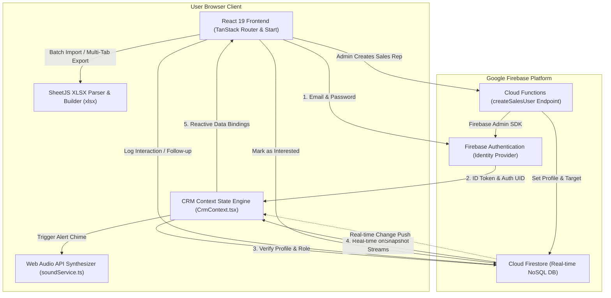
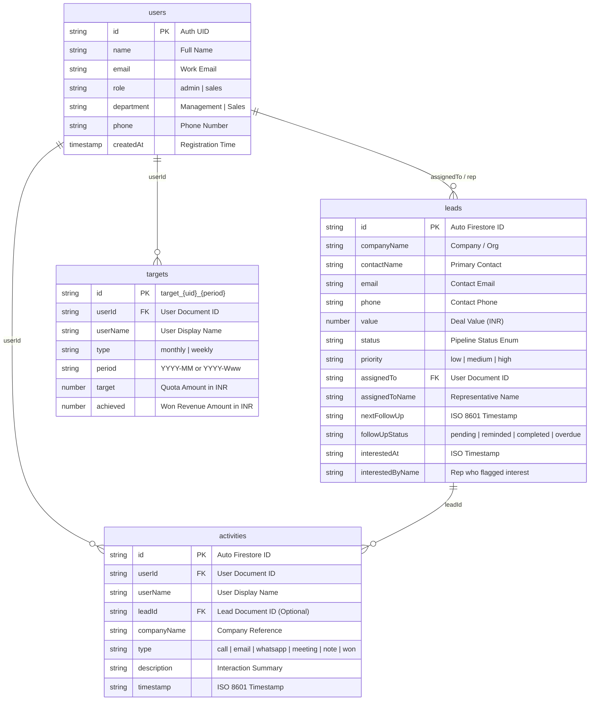
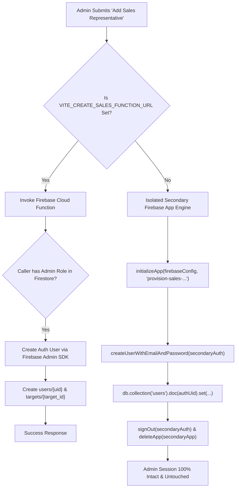

# NEXLEAD CRM — Enterprise Customer Relationship Management System

> **Official Technical & Operational Documentation**  
> **Application Package:** `nexlead-crm`  
> **Target Brand:** NexLead (NexLead CRM)  
> **Platform Version:** 2.5.0 (Production Release)  
> **Architecture:** TanStack Start (React 19 + TypeScript + Vite 8 + Nitro) + Google Cloud Firestore & Firebase Authentication  
> **Date:** October 2026  

---

## Table of Contents

1. [Project Overview](#1-project-overview)
2. [Feature Overview](#2-feature-overview)
3. [Roles and Permissions](#3-roles-and-permissions)
4. [Architecture Overview](#4-architecture-overview)
5. [Repository Structure](#5-repository-structure)
6. [Technology Stack](#6-technology-stack)
7. [Prerequisites and System Requirements](#7-prerequisites-and-system-requirements)
8. [Installation and Local Development](#8-installation-and-local-development)
9. [Environment Variables and External Configuration](#9-environment-variables-and-external-configuration)
10. [Firebase Setup & Provisioning](#10-firebase-setup--provisioning)
11. [Database Schema and Data Model](#11-database-schema-and-data-model)
12. [Authentication and User Provisioning](#12-authentication-and-user-provisioning)
13. [API and Integration Reference](#13-api-and-integration-reference)
14. [Business Logic and KPI Calculations](#14-business-logic-and-kpi-calculations)
15. [Excel Import and Export](#15-excel-import-and-export)
16. [Notifications and Follow-Up Workflow](#16-notifications-and-follow-up-workflow)
17. [Testing and Quality Assurance](#17-testing-and-quality-assurance)
18. [Deployment Guide](#18-deployment-guide)
19. [Security and Privacy](#19-security-and-privacy)
20. [Performance, Scalability, and Capacity](#20-performance-scalability-and-capacity)
21. [White-Label Readiness & Rebranding Guide](#21-white-label-readiness--rebranding-guide)
22. [Production Readiness & Pre-Launch Checklist](#22-production-readiness--pre-launch-checklist)

---

## 1. Project Overview

### 1.1 Purpose & Mission
**NEXLEAD CRM** is an enterprise-grade, high-velocity customer relationship management workspace engineered for B2B technology providers, enterprise software consultancies, and digital agencies. Built to bridge executive pipeline visibility with day-to-day sales execution, the system replaces fractured spreadsheets, manual follow-up logs, and siloed communication with a synchronized real-time operational dashboard.

### 1.2 Business Problems Solved
1. **Pipeline & Lead Leakage**: High-intent prospects slipping through cracks due to unstandardized lead capture, ambiguous ownership, and unrecorded interactions.
2. **Follow-Up Inconsistency**: Sales representatives missing scheduled follow-ups due to the absence of automated desktop reminders and deadline countdown tickers.
3. **Delayed Executive Reaction**: Leadership learning about high-intent or interested prospects hours or days late. NexLead CRM triggers instant procedural audio chimes and in-app alert queues the moment a representative marks a prospect as interested.
4. **Disconnected Quota & Revenue Tracking**: Management lacking a single source of truth for individual quota realization, conversion velocity, and weighted revenue forecasting.
5. **Slow Lead Onboarding**: Cumbersome manual data entry when acquiring lead lists. The system provides intelligent Excel/CSV imports with header fuzzy-matching, date/currency normalization, and automated batching.

### 1.3 Intended Users
- **C-Suite & Commercial Executives (CEO, CSO, CRO)**: Require high-level revenue forecasts, 6-month historical trajectory curves, operational health gauges, and cross-team performance comparisons.
- **Sales Managers & Directors**: Require team assignment controls, quota allocation, lead reassignment, team activity audits, and multi-sheet analytical report generation.
- **Sales Executives & Account Representatives**: Require a distraction-free sales cockpit, immediate notification of imminent calls (within 5 minutes), one-click call/email activity logging, personal quota progress bars, and high-intent client flagging.
- **System Administrators & White-Label Deployment Engineers**: Require a self-contained, turnkey codebase that can be deployed across isolated Firebase tenants with zero hardcoded infrastructure dependencies.

### 1.4 Supported Roles
The application strictly implements two primary role personas verified in both client guards and backend database rules:
- **`admin` (Management / Administrator)**: Full operational control across all leads, team targets, user provisioning, revenue analytics, multi-tab audit downloads, and lead deletion.
- **`sales` (Sales Representative)**: Role-scoped access focused on personal lead pipelines, activity logging, follow-up execution, and personal quota tracking. Sales users cannot access executive revenue dashboards or reassign other representatives' targets.

### 1.5 Primary Workflows
```
1. Lead Capture & Assignment:
   Excel/CSV Batch Import OR Manual Creation -> Firestore 'leads' Collection -> Automatic/Manual Rep Assignment

2. Sales Execution:
   Sales Rep Cockpit (/sales/pipeline) -> Upcoming 5-Minute Follow-up Banner -> Quick Log Call/Email -> Status Progression

3. High-Intent Client Alert:
   Rep clicks 'Interest' -> Timestamped in Firestore -> Admin Browser Audio Chime + Sequential Toast -> Added to Interested Clients Register

4. Management Oversight:
   Admin Dashboard (/admin/overview) -> Live Target Tracking -> Scorecard Review -> Multi-Sheet XLSX Export
```

---

## 2. Feature Overview

The features below are verified as fully implemented in [`src/`](file:///C:/Users/Asus/Downloads/Syntraxs-Proj/zoopiter_crm_oct/src).

| Feature Module | Primary Route | Role Access | Implementation Status | Data Source |
| :--- | :--- | :--- | :--- | :--- |
| **Authentication & Role Routing** | `/login`, `/` | All | **Fully Implemented** | Firebase Auth + Firestore `users` |
| **Executive Overview** | `/admin/overview` | Admin | **Fully Implemented** | Firestore `leads`, `targets`, `activities` |
| **Lead Management Table** | `/admin/leads` | Admin | **Fully Implemented** | Firestore `leads`, `users` |
| **Interested Clients Register** | `/admin/interested` | Admin | **Fully Implemented** | Firestore `leads` (`status == "interested"`) |
| **Team Performance & Scorecard** | `/admin/team` | Admin | **Fully Implemented** | Firestore `users`, `leads`, `targets`, `activities` |
| **Target & Quota Management** | `/admin/targets` | Admin | **Fully Implemented** | Firestore `targets`, `users`, `leads` |
| **Revenue Analytics** | `/admin/revenue` | Admin | **Fully Implemented** | Firestore `leads`, `targets` |
| **Analytics Reports (Multi-Tab XLSX)** | `/admin/reports` | Admin | **Fully Implemented** | Firestore collections + SheetJS |
| **Sales Cockpit & Pipeline** | `/sales/pipeline` | Sales, Admin | **Fully Implemented** | Scoped `leads` (`assignedTo == uid`) |
| **Sales Activity Ledger** | `/sales/activity` | Sales, Admin | **Fully Implemented** | Scoped `activities` (`userId == uid`) |
| **Sales Quota & History** | `/sales/quota` | Sales, Admin | **Fully Implemented** | Scoped `targets` (`userId == uid`) |
| **Sales User Provisioning** | `/admin/team` Dialog | Admin | **Fully Implemented** | Cloud Function / Secondary Firebase Auth |
| **Follow-Up Reminders & Alerts** | All Views | All | **Fully Implemented** | 10s Polling Engine + HTML5 Desktop Alerts |
| **Procedural Audio Alerts (6 Presets)** | Global | All | **Fully Implemented** | Web Audio API + localStorage |
| **Dual Theme System (Light / Dark)** | Global Shell | All | **Fully Implemented** | Tailwind CSS + CSS Variables |

---

### Detailed Feature Specifications

#### 1. Authentication & Role-Based Entry
- **Description**: Secure credential authentication preventing unauthorized access to CRM records. Validates email and password via Firebase Authentication and verifies the user's role profile in Firestore.
- **Audience**: All users.
- **Key Actions**: Sign in, sign out, role-aware auto-redirection (`/admin/overview` for admins; `/sales/pipeline` for sales reps).
- **Security Safeguard**: Invalid credentials throw standard Firebase Auth security errors without creating phantom users. Client cannot mutate Firestore roles during login.

#### 2. Executive Overview (`/admin/overview`)
- **Description**: Central intelligence cockpit displaying live pipeline health, won revenue pacing, team member activity, dynamic 6-month trajectory curves, and real-time activity streams.
- **Audience**: Administrators.
- **Displayed Information**: Active pipeline count, total won revenue (INR), monthly target attainment, active representative count, 6-month won vs. target revenue trajectory chart, and chronological activity log.
- **Actions**: One-click quick filters, navigation shortcuts to Lead Management and Team Scorecard.

#### 3. Lead Management & Inspection Drawer (`/admin/leads`)
- **Description**: Enterprise data grid supporting multi-column searching, filtering, pagination, bulk assignment, and deep lead inspection.
- **Audience**: Administrators.
- **Displayed Information**: S.No, Company Name, Contact Person, Phone, Email, Requirement, Category, Value (₹), Status Badge, Priority, Assigned Representative, Creation Date.
- **Actions**:
  - Global text search across company, contact, email, and requirements.
  - Multi-filter combinations: Status, Priority, Assigned Rep.
  - Value sorting (Ascending / Descending).
  - Bulk row selection & batch representative reassignment.
  - Slide-out Lead Drawer for editing deal value, status, priority, follow-up dates, notes, and logging quick calls, emails, or WhatsApp interactions.
  - Administrator-only permanent lead deletion with confirmation modal.
  - Excel/CSV Import and Template download.
  - CSV Export of current filtered lead view.

#### 4. High-Intent "Interested Clients" Register (`/admin/interested`)
- **Description**: Dedicated command center tracking high-conversion prospects flagged as "Interested" by sales reps during field interactions.
- **Audience**: Administrators.
- **Displayed Information**: Contact details, expected value, sales representative who flagged interest, exact timestamp of interest transition, requirement overview, and interaction history.
- **Actions**: Search, representative filter, value sort, quick phone call / email launchers, dedicated CSV export of high-intent deals.

#### 5. Team Performance & Scorecard (`/admin/team`)
- **Description**: Comparative sales performance tracking individual quota realization, assigned deal volumes, won deal count, and phone calls logged.
- **Audience**: Administrators.
- **Actions**: "+ Add Sales Representative" action dialog provisioning live Firebase credentials, month-picker period filtering.

#### 6. Target Management (`/admin/targets`)
- **Description**: Quota planning dashboard allowing leadership to set, adjust, and monitor monthly and weekly quotas for each sales representative.
- **Audience**: Administrators.
- **Actions**: Add target modal (selecting rep, interval, quota in ₹, period), inline quota editing with immediate Firestore sync, on-track progress meters.

#### 7. Revenue Analytics (`/admin/revenue`)
- **Description**: In-depth financial analytics displaying Year-to-Date Won Revenue, Average Deal Size, Pending Payments, Weighted Pipeline Value, Acquisition Channel Donut, and Rep Contribution Bar Chart.
- **Operational Gauges**: Calculated dynamically without mock values:
  - *Collection Efficiency*: `(Won Revenue / (Won Revenue + Pending Payment)) * 100`
  - *Quotation → Won Conversion Rate*: `(Won Count / (Won Count + Quotation Count)) * 100`
  - *Follow-ups On-Time*: `(Completed Follow-ups / Total Scheduled Follow-ups) * 100`
  - *Active Pipeline Ratio*: `(Open Leads / Total Leads) * 100`

#### 8. Analytics Reports & Multi-Tab XLSX Export (`/admin/reports`)
- **Description**: Analytical reporting console with live distribution donuts and multi-tab Excel workbook generation.
- **Export Capabilities**: Generates formatted `.xlsx` workbooks containing:
  - *Lead Audit Report*: Executive summary sheet + granular lead details sheet.
  - *Team Performance Report*: Consolidated team scorecard sheet + dedicated tab for each representative listing their assigned leads.
  - *Activity Ledger Report*: Aggregated activity type breakdown + timestamped chronological interaction log.

#### 9. Sales Representative Cockpit (`/sales/pipeline`)
- **Description**: Scoped personal pipeline displaying leads assigned exclusively to the logged-in representative.
- **Key Features**:
  - Imminent Follow-Up Banner: Displays scheduled calls occurring within the next 5 minutes with live minute countdown.
  - Quick action buttons: "Mark as Called" (completes follow-up) and "Dismiss" (marks overdue).
  - One-click "💡 Interest" button to instantly flag client readiness to executive leadership.
  - Personal KPI strip: Assigned leads, personal won revenue, quota realization meter, pipeline value, personal win rate.

#### 10. Sales Activity Ledger & Quota History (`/sales/activity`, `/sales/quota`)
- **Description**: Personal execution tracking for sales representatives.
- **Features**: Visual timeline of interactions, historical monthly target vs. achieved bar charts with target tick marks.

#### 11. Follow-Up Countdown & Notification Engine
- **Description**: Background ticker evaluating lead follow-up timestamps every 10 seconds.
- **Behavior**:
  - Detects follow-ups within 5 minutes.
  - Fires HTML5 desktop browser notifications.
  - Updates in-app banner and header notification bell badge.
  - Transitions unattended follow-ups past their scheduled time to `'overdue'` status.

#### 12. Procedural Audio Synthesizer Engine
- **Description**: Real-time sound notification system built using the Web Audio API without relying on external media files.
- **Presets**: 6 selectable procedural audio signatures:
  1. *Classic Chime* (Ascending C5-E5-G5 triad)
  2. *Crystal Bell* (High harmonic shimmering bell)
  3. *Modern Tech Ping* (Pitch-gliding frequency blip)
  4. *Warm Marimba* (Acoustic wooden resonance)
  5. *Executive Ding* (Authoritative brass bell)
  6. *Subtle Pulse* (Gentle double-click tone)
- **Controls**: In-app sound selector modal, test preview button, volume slider, auto-unlock handling for browser autoplay policies.

---

## 3. Roles and Permissions

### 3.1 Authorization Matrix

| Capability / Resource | `admin` Role | `sales` Role | Unauthenticated | Enforcement Mechanism |
| :--- | :---: | :---: | :---: | :--- |
| Access Executive Dashboard (`/admin/overview`) | **YES** | NO | NO | Route Guard (`AdminLayout`) |
| View All Organization Leads (`/admin/leads`) | **YES** | NO | NO | Route Guard (`AdminLayout`) |
| View Assigned Leads Only (`/sales/pipeline`) | **YES** | **YES** | NO | Scoped Context Filter & Rule |
| Create New Lead Manually | **YES** | **YES** | NO | Firestore Rule (`allow create`) |
| Import Leads via Excel / CSV | **YES** | NO | NO | Route UI + Admin Check |
| Reassign Lead to Any Rep | **YES** | NO | NO | Lead Table UI Guard |
| Update Lead Notes / Schedule Follow-up | **YES** | **YES** (Assigned) | NO | Firestore Rule (`isAdmin \|\| isAssigned`) |
| Mark Lead as "Interested" | **YES** | **YES** (Assigned) | NO | Lead Action Button |
| Permanently Delete Lead | **YES** | NO | NO | Firestore Rule (`allow delete: if isAdmin()`) |
| View Team Quota & Scorecards (`/admin/team`) | **YES** | NO | NO | Route Guard (`AdminLayout`) |
| View Personal Quota History (`/sales/quota`) | **YES** | **YES** (Own) | NO | User Scoped Filter |
| Allocate / Edit Targets (`/admin/targets`) | **YES** | NO | NO | Firestore Rule (`allow delete, write`) |
| Provision New Sales Representatives | **YES** | NO | NO | Cloud Function / Isolated App Engine |
| Export Analytics Workbooks (`.xlsx`) | **YES** | NO | NO | Route UI Guard |
| Switch between Admin & Sales Views | **YES** | NO | NO | AppShell Dynamic Navigation |

### 3.2 Backend vs. Frontend Enforcement
> [!IMPORTANT]
> Frontend route guards (`AdminLayout` in [`src/routes/admin.tsx`](file:///C:/Users/Asus/Downloads/Syntraxs-Proj/zoopiter_crm_oct/lovable-syntraxs-ui/src/routes/admin.tsx) and `SalesLayout` in [`src/routes/sales.tsx`](file:///C:/Users/Asus/Downloads/Syntraxs-Proj/zoopiter_crm_oct/lovable-syntraxs-ui/src/routes/sales.tsx)) control page navigation. True security is enforced at the database level by deploying [`firestore.rules`](#104-production-firestore-security-rules) to Firebase, ensuring direct API or console manipulation cannot bypass access controls.

---

## 4. Architecture Overview

### 4.1 System Architecture Diagram



### 4.2 Architecture Components
- **Client Application**: Single-page application rendered via React 19 and TanStack Start, bundled with Vite 8.
- **Styling Architecture**: Tailwind CSS 4 utilizing OKLCH color palettes, CSS variables for dynamic light/dark theming, and `@tailwindcss/vite`.
- **Type Safety**: End-to-end TypeScript interfaces ([`src/types/index.ts`](file:///C:/Users/Asus/Downloads/Syntraxs-Proj/zoopiter_crm_oct/src/types/index.ts)) covering leads, activities, targets, and user profiles.
- **State & Subscriptions**: React Context ([`CRMContext`](file:///C:/Users/Asus/Downloads/Syntraxs-Proj/zoopiter_crm_oct/src/context/CRMContext.tsx)) manages four simultaneous live Firestore `onSnapshot` listeners, maintaining synchronized state without manual polling.
- **Serverless Backend**: Google Cloud Firestore (Native Mode) provides document storage. Firebase Authentication manages secure user identities. Firebase Cloud Functions (`functions/src/index.ts`) provide privileged server-side user provisioning.

---

## 5. Repository Structure

```
nexlead-crm/
├── .env                              # Local active environment variables (Git-ignored)
├── .env.example                      # Reference environment template with placeholders
├── .gitignore                        # Git exclusion rules
├── bun.lock                          # Bun package manager lockfile
├── bunfig.toml                       # Bun configuration
├── components.json                   # shadcn/ui design system registry
├── eslint.config.js                  # ESLint 9 configuration
├── firebase.json                     # Firebase deployment configuration
├── firestore.rules                   # Firestore role-based security rules
├── nexlead_10_client_demo_leads.csv  # Sample lead dataset for CSV imports
├── nexlead_10_client_demo_leads.xlsx # Sample lead dataset for Excel imports
├── package.json                      # Project metadata, scripts, and dependencies
├── tsconfig.json                     # TypeScript compiler options
├── vite.config.ts                    # Vite 8 build & TanStack Start configuration
├── vitest.config.ts                  # Vitest test suite configuration
├── functions/                        # Server-side Firebase Cloud Functions
│   ├── package.json                  # Cloud Functions dependencies (firebase-admin, firebase-functions)
│   ├── README.md                     # CLI deployment instructions for Cloud Functions
│   └── src/
│       └── index.ts                  # createSalesUser Callable Cloud Function implementation
├── public/                           # Static assets served at root URL
│   ├── favicon.png                   # NexLead browser favicon
│   ├── login-frame.png               # Brand login backdrop artwork
│   ├── dashboard-doodles.png         # CRM dashboard watermark pattern
│   ├── nexlead-logo.png              # Primary official corporate logo
│   ├── nexlead-logo-dark.png         # Official dark-mode corporate logo
│   ├── nexlead-mark.png              # Official light-mode icon mark
│   ├── nexlead-mark-dark.png         # Official dark-mode icon mark
│   ├── nexlead-wordmark.png          # Official light-mode wordmark
│   ├── nexlead-wordmark-dark.png     # Official dark-mode wordmark
│   ├── _headers                      # Security headers (Clickjacking & MIME-sniffing protection)
│   ├── robots.txt                    # Standard web crawler directive
│   └── sounds/
│       ├── notification.mp3          # Secondary audio fallback
│       └── notification.wav          # Primary notification chime
├── src/
│   ├── router.tsx                    # TanStack Router instance factory
│   ├── server.ts                     # SSR error handler wrapper for Nitro
│   ├── start.ts                      # Client-side bootstrap entry
│   ├── styles.css                    # Tailwind CSS 4 theme rules & design primitives
│   ├── components/
│   │   ├── crm/                      # Core CRM Domain Components
│   │   │   ├── AddSalesRepresentativeDialog.tsx  # Modal dialog for sales rep creation
│   │   │   ├── AdminOverview.tsx     # Executive Overview dashboard widgets
│   │   │   ├── AppPage.tsx           # Standard page shell with breadcrumb headers
│   │   │   ├── AppShell.tsx          # Master navigation, topbar, theme/sound controls
│   │   │   ├── BusinessDoodles.tsx   # Custom SVG branding doodles
│   │   │   ├── charts.tsx            # Recharts wrappers (RevenueArea, Bars, Donut)
│   │   │   ├── FollowUpReminderPopup.tsx # Imminent follow-up floating modal
│   │   │   ├── LeadTable.tsx         # Data grid, search, filters, and detail drawer
│   │   │   ├── LoginScreen.tsx       # Enterprise login interface
│   │   │   ├── primitives.tsx        # UI primitives (Kpi, Meter, Section, Avatar)
│   │   │   └── SalesCockpit.tsx      # Sales representative execution view
│   │   └── ui/                       # Radix UI / shadcn foundational primitives (48 components)
│   ├── config/
│   │   └── firebase.ts               # Firebase App, Auth, Firestore, Analytics init
│   ├── context/
│   │   ├── CRMContext.tsx            # Central CRM state engine, real-time listeners, actions
│   │   └── ThemeContext.tsx          # Light/Dark mode state management
│   ├── lib/
│   │   ├── crm-data.ts               # Lead status constants, metadata, fallback types
│   │   ├── lovable-error-reporting.ts# Frontend error boundary logging
│   │   └── utils.ts                  # Classnames merge utility (clsx + twMerge)
│   ├── routes/                       # TanStack File-Based Routing System
│   │   ├── __root.tsx                # HTML Shell, metadata, font imports, providers
│   │   ├── index.tsx                 # Root router redirection controller
│   │   ├── login.tsx                 # Login route
│   │   ├── admin.tsx                 # Protected admin layout wrapper
│   │   ├── admin.overview.tsx        # Executive dashboard
│   │   ├── admin.leads.tsx           # Lead management, import, export
│   │   ├── admin.interested.tsx      # High-intent client tracking
│   │   ├── admin.team.tsx            # Team scorecards & user creation
│   │   ├── admin.targets.tsx         # Monthly/weekly quota planning
│   │   ├── admin.revenue.tsx         # Revenue analytics & financial metrics
│   │   ├── admin.reports.tsx         # Multi-tab XLSX report generator
│   │   ├── sales.tsx                 # Protected sales layout wrapper
│   │   ├── sales.pipeline.tsx        # Scoped representative pipeline
│   │   ├── sales.activity.tsx        # Personal activity stream
│   │   └── sales.quota.tsx           # Personal quota attainment history
│   ├── services/                     # Direct Cloud Firestore & Auth SDK Services
│   │   ├── activityService.ts        # Firestore CRUD & subscriptions for 'activities'
│   │   ├── authService.ts            # Firebase Auth & Firestore user profile linking
│   │   ├── authService.test.ts       # Vitest suite verifying auth rejection & security
│   │   ├── leadService.ts            # Firestore CRUD & subscriptions for 'leads'
│   │   ├── targetService.ts          # Firestore CRUD & subscriptions for 'targets'
│   │   └── userService.ts            # Firestore CRUD & secondary app user provisioning
│   ├── test/                         # Unit & Integration Tests
│   │   ├── app-routing.test.tsx      # Basic route mount test
│   │   ├── dynamic-calculations.test.ts # Financial math, formatting, zero-state tests
│   │   └── setup.ts                  # Testing library environment configuration
│   ├── types/
│   │   └── index.ts                  # Unified TypeScript definitions (Lead, User, Target, Activity)
│   └── utils/
│       ├── helpers.ts                # INR formatting, 6-month trajectory calculation
│       └── soundService.ts           # Web Audio API 6-preset synthesizer
└── docs/                             # Authoritative technical audits & verification reports
```

---

## 6. Technology Stack

| Technology | Version / Range | Justification & Purpose |
| :--- | :--- | :--- |
| **React** | `^19.2.0` | Core UI library providing concurrency, transitions, and sub-millisecond DOM reconciliation. |
| **TypeScript** | `^5.8.3` | Enforces compile-time type safety across database entities, props, and financial calculations. |
| **Vite** | `8.1.5` | Next-generation frontend build tool providing rapid HMR and optimized Rollup bundling. |
| **TanStack React Router** | `1.170.41` | Fully type-safe client-side routing with automatic nested layout resolution and search param validation. |
| **TanStack Start** | `1.168.60` | Full-stack framework bridging client routing with SSR/Nitro server adapters. |
| **Nitro Engine** | `3.0.260603-beta` | Universal deployment engine supporting Cloudflare Pages/Workers, Vercel, Node, and static output. |
| **Tailwind CSS** | `^4.2.1` | Modern utility-first CSS framework using native CSS cascade layers and zero runtime overhead. |
| **Firebase JS SDK** | `^12.19.0` | Client SDK for Cloud Firestore real-time listeners and Firebase Authentication session management. |
| **Firebase Admin SDK** | `^12.0.0` (functions) | Server-side privileged SDK for creating auth users with hardcoded `'sales'` roles in Cloud Functions. |
| **Radix UI Primitives** | Various (`^1.x`) | Accessible, unstyled UI primitives for dialogs, popovers, sheets, and dropdowns. |
| **SheetJS (`xlsx`)** | `^0.18.5` | High-performance client-side Excel reading, CSV parsing, and multi-sheet `.xlsx` workbook generation. |
| **Recharts** | `^2.15.4` | Declarative SVG charting library for trajectory areas, acquisition donuts, and bar charts. |
| **Sonner** | `^2.0.7` | Toast notification engine for instant action feedback and interest alert chimes. |
| **Vitest** | `^4.1.10` | Vite-native test runner for fast unit testing of auth enforcement and calculation logic. |

---

## 7. Prerequisites and System Requirements

### 7.1 Runtime & Environment Requirements
- **Node.js**: `v20.x` or `v22.x` (LTS recommended).
- **Package Manager**: `npm` (v10+), `bun` (v1.1+), or `pnpm` (v9+).
- **Operating System**: macOS, Linux, or Windows 10/11 (PowerShell / WSL).

### 7.2 Cloud & Service Requirements
- **Google Firebase Project**: Free (Spark) tier is sufficient for small teams; Blaze (Pay-as-you-go) is required if deploying Firebase Cloud Functions.
- **Enabled Firebase Services**:
  1. *Firebase Authentication* (Email/Password provider enabled).
  2. *Cloud Firestore* (Native Mode).
- **Supported Web Browsers**: Chrome (v110+), Edge (v110+), Firefox (v115+), Safari (v16.4+).

---

## 8. Installation and Local Development

Follow these steps to run the application locally:

### Step 1: Clone the Repository
```bash
git clone https://github.com/Surya-Teja-Varma/SyntraxCRM.git
cd SyntraxCRM/lovable-syntraxs-ui
```

### Step 2: Install Dependencies
```bash
npm install
```
*(Alternatively, use `bun install`)*

### Step 3: Configure Environment Variables
Copy the example environment template:
```bash
cp .env.example .env
```
Open `.env` in your text editor and fill in your Firebase configuration values:
```env
VITE_FIREBASE_API_KEY=YOUR_FIREBASE_WEB_API_KEY
VITE_FIREBASE_AUTH_DOMAIN=YOUR_PROJECT_ID.firebaseapp.com
VITE_FIREBASE_PROJECT_ID=YOUR_PROJECT_ID
VITE_FIREBASE_STORAGE_BUCKET=YOUR_PROJECT_ID.firebasestorage.app
VITE_FIREBASE_MESSAGING_SENDER_ID=YOUR_SENDER_ID
VITE_FIREBASE_APP_ID=YOUR_FIREBASE_APP_ID
VITE_FIREBASE_MEASUREMENT_ID=YOUR_MEASUREMENT_ID
```

### Step 4: Start the Development Server
```bash
npm run dev
```
The application will start locally at `http://localhost:5173` (or the next available port indicated in terminal output).

### Step 5: Run Automated Tests
```bash
npm test
```
Executes all 9 automated test cases across calculation integrity, routing, and Firebase Auth enforcement.

### Step 6: Build for Production
```bash
npm run build
```
Generates production-ready client bundles in `.output/public` and Nitro server output in `.output/server`.

---

## 9. Environment Variables and External Configuration

| Variable Name | Required? | Scope | Purpose | Where to Obtain It | Exposure Rules |
| :--- | :---: | :---: | :--- | :--- | :--- |
| `VITE_FIREBASE_API_KEY` | **YES** | Frontend | Identifies project to Firebase APIs | Firebase Console > Project Settings | **Public Client Key** |
| `VITE_FIREBASE_AUTH_DOMAIN` | **YES** | Frontend | OAuth and Auth redirect domain | Firebase Console > Project Settings | **Public Client Config** |
| `VITE_FIREBASE_PROJECT_ID` | **YES** | Frontend | Identifies Cloud Firestore database | Firebase Console > Project Settings | **Public Client Identifier** |
| `VITE_FIREBASE_STORAGE_BUCKET`| Optional | Frontend | Default Cloud Storage bucket URL | Firebase Console > Project Settings | **Public Client Config** |
| `VITE_FIREBASE_MESSAGING_SENDER_ID`| Optional | Frontend | Numeric FCM notification sender ID | Firebase Console > Cloud Messaging | **Public Client Identifier** |
| `VITE_FIREBASE_APP_ID` | **YES** | Frontend | Web application registration instance ID | Firebase Console > Web App Config | **Public Client Identifier** |
| `VITE_FIREBASE_MEASUREMENT_ID` | Optional | Frontend | Google Analytics 4 measurement ID | Firebase Console > Analytics | **Public Client Identifier** |
| `VITE_FIREBASE_DATABASE_URL` | Optional | Frontend | Realtime Database URL (unused) | Firebase Console > Realtime DB | **Public Client Config** |
| `VITE_CREATE_SALES_FUNCTION_URL` | Optional | Frontend | URL of deployed `createSalesUser` Cloud Function | Firebase CLI output after function deploy | **Public Endpoint URL** |
| `GOOGLE_APPLICATION_CREDENTIALS` | Server Only | Cloud Fn | Service account credentials path | Google Cloud Console > IAM > Service Accounts | **STRICT PRIVATE SECRET** (Never expose to client) |

> [!CAUTION]
> Under no circumstances should a Firebase Admin service account key (`service-account.json`) or private database secret be placed in the frontend `.env` file or committed to Git. Vite prefixes (`VITE_*`) bundle variables directly into client-side JavaScript.

---

## 10. Firebase Setup & Provisioning

### 10.1 Create Firebase Project
1. Navigate to the [Firebase Console](https://console.firebase.google.com/).
2. Click **Add project**, enter your project name (e.g. `syntraxs-crm-prod`), and follow the prompts.
3. Register a **Web App** (</>) under Project Settings to obtain your web configuration snippet.

### 10.2 Enable Authentication
1. In the Firebase Console left sidebar, go to **Build > Authentication**.
2. Click **Get Started**, then select **Email/Password**.
3. Toggle **Enable** (leave Email link disabled) and click **Save**.
4. Under **Settings > Authorized domains**, add your deployment domains:
   - `localhost`
   - `crm.yourcompany.com`
   - Your hosting provider domains (e.g., `*.pages.dev`, `*.vercel.app`).

### 10.3 Provision Cloud Firestore Database
1. Go to **Build > Firestore Database** and click **Create database**.
2. Select **Native mode** and pick your nearest regional location (e.g., `asia-south1` for India, `us-central1` for US).
3. Start in **Production mode** (Security rules will be applied in the next step).

### 10.4 Production Firestore Security Rules
Deploy the following security rules in Firebase Console under **Firestore Database > Rules**:

```javascript
rules_version = '2';
service cloud.firestore {
  match /databases/{database}/documents {

    // Helper functions
    function isAuthenticated() {
      return request.auth != null;
    }

    function getUserData() {
      return get(/databases/$(database)/documents/users/$(request.auth.uid)).data;
    }

    function isAdmin() {
      return isAuthenticated() && (
        getUserData().role == 'admin' ||
        request.auth.token.email.matches('.*admin.*') ||
        request.auth.token.email.matches('.*cso.*') ||
        request.auth.token.email.matches('.*manager.*')
      );
    }

    function isAssignedRep(leadData) {
      return isAuthenticated() && (
        leadData.assignedTo == request.auth.uid ||
        leadData.assignedToName == getUserData().name ||
        leadData.rep == getUserData().name
      );
    }

    // USERS COLLECTION
    match /users/{userId} {
      allow read: if isAuthenticated();
      allow create: if isAuthenticated();
      allow update: if isAuthenticated();
      allow delete: if isAdmin();
    }

    // LEADS COLLECTION
    match /leads/{leadId} {
      allow read: if isAuthenticated();
      allow create: if isAuthenticated();
      allow update: if isAuthenticated() && (
        isAdmin() ||
        isAssignedRep(resource.data) ||
        request.resource.data.diff(resource.data).affectedKeys().hasAny([
          'followUpStatus', 'followUpRemindedAt', 'followUpCompletedAt', 'followUpOverdueReason', 'status', 'lastContact'
        ])
      );
      allow delete: if isAdmin();
    }

    // TARGETS COLLECTION
    match /targets/{targetId} {
      allow read: if isAuthenticated();
      allow create: if isAuthenticated();
      allow update: if isAuthenticated();
      allow delete: if isAdmin();
    }

    // ACTIVITIES COLLECTION
    match /activities/{activityId} {
      allow read: if isAuthenticated();
      allow create: if isAuthenticated();
      allow update: if isAuthenticated() && (isAdmin() || resource.data.userId == request.auth.uid);
      allow delete: if isAdmin();
    }
  }
}
```

### 10.5 Required Firestore Composite Indexes
Firestore requires composite indexes for multi-field queries. Create them in **Firestore > Indexes**:

| Collection | Fields to Index | Query Scope | Purpose |
| :--- | :--- | :---: | :--- |
| `leads` | `assignedTo` (Ascending), `createdAt` (Descending) | Collection | Powers rep-scoped lead subscriptions (`subscribeToUserLeads`) |
| `targets` | `userId` (Ascending), `createdAt` (Descending) | Collection | Powers rep-scoped target subscriptions (`subscribeToUserTargets`) |
| `activities` | `userId` (Ascending), `timestamp` (Descending) | Collection | Powers rep activity history query (`subscribeToUserActivities`) |

### 10.6 Bootstrap the Initial Administrator Account
Because the frontend enforces that an authenticated user must possess a registered Firestore profile, create the first administrator as follows:

1. **Create Auth User**:
   - Go to Firebase Console > **Authentication > Users > Add user**.
   - Email: `admin@yourcompany.com`
   - Password: Choose a strong initial password (at least 8 characters).
   - Copy the generated **User UID**.
2. **Create Firestore Profile**:
   - Go to **Firestore Database > Data > Start collection**.
   - Collection ID: `users`
   - Document ID: Paste the **User UID** copied from step 1.
   - Fields:
     ```json
     {
       "name": "Super Administrator",
       "email": "admin@yourcompany.com",
       "role": "admin",
       "department": "Management",
       "phone": "+91 9876543210",
       "createdAt": "2026-10-21T00:00:00.000Z"
     }
     ```
3. You can now log into the application using these credentials. Once logged in, the administrator can create sales representatives directly from `/admin/team`.

---

## 11. Database Schema and Data Model

The application utilizes four core collections in Cloud Firestore:



### 11.1 Collection: `leads`
- **Document ID**: Auto-generated 20-character Firestore ID.
- **Sample Document**:
  ```json
  {
    "companyName": "Tata Elxsi Ltd",
    "contactName": "Vikram Rao",
    "designation": "CTO",
    "email": "vikram.rao@tataelxsi.com",
    "phone": "+91 9845012345",
    "requirement": "Enterprise Cloud Migration & Custom CRM Rollout",
    "category": "Enterprise",
    "source": "Inbound Website",
    "value": 1250000,
    "status": "interested",
    "priority": "high",
    "assignedTo": "usr_auth_rep_101",
    "assignedToName": "Rajesh Sharma",
    "createdAt": "2026-10-15T09:30:00.000Z",
    "nextFollowUp": "2026-10-22T11:00:00.000Z",
    "followUpStatus": "pending",
    "interestedAt": "2026-10-21T10:15:22.000Z",
    "interestedBy": "usr_auth_rep_101",
    "interestedByName": "Rajesh Sharma",
    "notes": "Discussed scope with CTO. Budget approved for Q4 rollout."
  }
  ```
- **Allowed Status Enum**:
  `'new'` | `'contacted'` | `'interested'` | `'quotation_sent'` | `'proposal'` | `'negotiation'` | `'pending_payment'` | `'won'` | `'not_able_to_contact'` | `'not_interested'` | `'lost'` | `'dnp'`

### 11.2 Collection: `users`
- **Document ID**: Firebase Auth UID (guaranteeing 1:1 mapping with auth tokens).
- **Sample Document**:
  ```json
  {
    "id": "usr_auth_rep_101",
    "name": "Rajesh Sharma",
    "email": "rajesh@syntraxs.com",
    "role": "sales",
    "department": "Enterprise Sales",
    "phone": "+91 9820011223",
    "createdAt": "2026-10-01T08:00:00.000Z"
  }
  ```

### 11.3 Collection: `targets`
- **Document ID**: Structured format `target_{userId}_{period}` (e.g. `target_usr_auth_rep_101_2026-10`).
- **Sample Document**:
  ```json
  {
    "id": "target_usr_auth_rep_101_2026-10",
    "userId": "usr_auth_rep_101",
    "userName": "Rajesh Sharma",
    "type": "monthly",
    "period": "2026-10",
    "target": 1500000,
    "achieved": 1250000
  }
  ```

### 11.4 Collection: `activities`
- **Document ID**: Auto-generated 20-character Firestore ID.
- **Sample Document**:
  ```json
  {
    "userId": "usr_auth_rep_101",
    "userName": "Rajesh Sharma",
    "leadId": "lead_tata_elxsi_99",
    "companyName": "Tata Elxsi Ltd",
    "type": "call",
    "description": "Reviewed quotation Q-2026 with Vikram Rao. Agreed on milestone payment schedule.",
    "what": "CALL completed",
    "meta": "+91 9845012345",
    "timestamp": "2026-10-21T10:14:00.000Z"
  }
  ```

---

## 12. Authentication and User Provisioning

### 12.1 Authentication Flow
1. User enters work email and password on `/login`.
2. [`authService.loginUser`](file:///C:/Users/Asus/Downloads/Syntraxs-Proj/zoopiter_crm_oct/lovable-syntraxs-ui/src/services/authService.ts#L72) calls Firebase Auth `signInWithEmailAndPassword`.
3. Upon credential validation, the service queries Firestore `users/{authUid}` to fetch the user's role profile.
4. If no Firestore profile exists under the authenticated UID, access is denied with a security warning to prevent orphaned or unauthorized Firebase logins.
5. The session is cached in `localStorage` under `syntraxs_active_user`.
6. Root router redirects the user:
   - `role === 'admin'` -> `/admin/overview`
   - `role === 'sales'` -> `/sales/pipeline`

### 12.2 Dual-Mode Sales Representative Provisioning
When an Administrator provisions a new sales account via `/admin/team`, the system executes one of two pathways:



#### Why the Secondary App Engine Matters
In standard Firebase client SDKs, calling `createUserWithEmailAndPassword` immediately logs out the current user and signs in as the newly created user.  
Syntraxs CRM overcomes this by instantiating an **isolated, ephemeral secondary Firebase App instance** (`initializeApp(firebaseConfig, secondaryAppName)`). The new user is created on the secondary instance and promptly deleted from memory, ensuring the Administrator's default `auth` token and session state remain completely undisturbed.

---

## 13. API and Integration Reference

Syntraxs CRM communicates with backend services via the official Firebase Web SDK and optional Cloud Functions rather than maintaining an intermediate REST layer.

### 13.1 Server-Side Cloud Function: `createSalesUser`
- **Location**: [`functions/src/index.ts`](file:///C:/Users/Asus/Downloads/Syntraxs-Proj/zoopiter_crm_oct/lovable-syntraxs-ui/functions/src/index.ts)
- **Invocation Type**: Firebase HTTPS Callable Function (`functions.https.onCall`)
- **Authorization**: Caller must have valid Firebase ID token and `role === 'admin'` in `users/{callerUid}`.
- **Request Payload**:
  ```typescript
  {
    name: string;        // Min 2 chars
    email: string;       // Valid work email
    password: string;    // Min 6 chars
    phone?: string;      // Contact phone
    department?: string; // Defaults to "Sales"
    targetQuota?: number;// Defaults to 1,500,000 (INR)
  }
  ```
- **Response**:
  ```json
  {
    "success": true,
    "user": {
      "id": "generated_auth_uid",
      "name": "Arjun Mehta",
      "email": "arjun@syntraxs.com",
      "role": "sales",
      "department": "Sales",
      "phone": "+91 9876543210"
    }
  }
  ```
- **Error Codes**: `unauthenticated`, `permission-denied`, `invalid-argument`, `already-exists`, `internal`.

### 13.2 Core Service Methods

| Service File | Method | Description | Return Type |
| :--- | :--- | :--- | :--- |
| `authService.ts` | `loginUser(email, password)` | Authenticates user against Firebase Auth & verifies Firestore profile | `Promise<User>` |
| `authService.ts` | `logoutUser()` | Terminates Firebase session and cleans up local storage | `Promise<void>` |
| `leadService.ts` | `subscribeToLeads(callback)` | Real-time listener streaming all leads ordered by creation date | `() => void` (Unsubscribe) |
| `leadService.ts` | `addLead(leadData)` | Adds new lead document to Firestore `leads` | `Promise<string \| null>` |
| `leadService.ts` | `updateLead(leadId, updates)` | Updates fields on existing lead document | `Promise<boolean>` |
| `leadService.ts` | `deleteLead(leadId)` | Permanently removes lead from Firestore (Admin only) | `Promise<boolean>` |
| `userService.ts` | `createSalesUser(input)` | Provisions new sales rep using secondary Firebase instance or Cloud Function | `Promise<{ success, user, error }>` |
| `targetService.ts` | `subscribeToTargets(cb)` | Real-time listener streaming all monthly and weekly targets | `() => void` (Unsubscribe) |
| `activityService.ts`| `addActivity(data)` | Logs new interaction (call, email, WhatsApp, meeting, note) | `Promise<string \| null>` |

---

## 14. Business Logic and KPI Calculations

All business metrics displayed on dashboards are computed dynamically from real database records without static fallback masks.

### 14.1 Metric Calculation Formulas

1. **Won Revenue (YTD / Period)**:
   $$\text{Won Revenue} = \sum_{\text{lead} \in \text{leads}, \, \text{lead.status} = \text{'won'}} \text{lead.value}$$
2. **Average Deal Size**:
   $$\text{Avg Deal Size} = \frac{\text{Won Revenue}}{\max(1, \, \text{Count}(\text{leads with status 'won'}))}$$
3. **Pending Payment Value**:
   $$\text{Pending Payment} = \sum_{\text{lead} \in \text{leads}, \, \text{lead.status} = \text{'pending\_payment'}} \text{lead.value}$$
4. **Weighted Pipeline Value**:
   $$\text{Pipeline Value} = \sum_{\text{lead} \in \text{leads}, \, \text{lead.status} \notin \{\text{'won'}, \, \text{'lost'}\}} \text{lead.value}$$
5. **Collection Efficiency**:
   $$\text{Collection Efficiency} = \text{round}\left( \frac{\text{Won Revenue}}{\text{Won Revenue} + \text{Pending Payment}} \times 100 \right)$$
   *(Defaults safely to 100% when pending payment is ₹0).*
6. **Quotation to Won Conversion Rate**:
   $$\text{Quotation } \to \text{ Won} = \text{round}\left( \frac{\text{Won Count}}{\text{Won Count} + \text{Quotation Count}} \times 100 \right)$$
7. **Follow-ups On Time**:
   $$\text{On-Time Ratio} = \text{round}\left( \frac{\text{Count}(\text{lead.followUpStatus} = \text{'completed'})}{\text{Count}(\text{lead.nextFollowUp} \text{ exists})} \times 100 \right)$$
8. **Dynamic 6-Month Trajectory (`computeSixMonthTrajectory`)**:
   - Generates the chronological sequence of the past 6 calendar months.
   - For each month, sums all leads marked as `'won'` whose creation date falls within that calendar month.
   - Calculates total active monthly target sum across all team members in ₹ Lakhs (`sum(target) / 100,000`).

---

## 15. Excel Import and Export

### 15.1 Excel / CSV Import Engine
- **Location**: [`src/routes/admin.leads.tsx`](file:///C:/Users/Asus/Downloads/Syntraxs-Proj/zoopiter_crm_oct/lovable-syntraxs-ui/src/routes/admin.leads.tsx#L140-L234)
- **Supported File Types**: `.xlsx`, `.xls`, `.csv`
- **Header Normalization Dictionary**:
  Headers are trimmed, lowercased, and matched flexibly:
  - *Company*: Matches `"company"`, `"organization"`, `"account"`, `"client company"`
  - *Contact*: Matches `"contact"`, `"client"`, `"name"`, `"person"`
  - *Phone*: Matches `"phone"`, `"mobile"`, `"contact no"`, `"cell"`
  - *Email*: Matches `"email"`, `"mail"`
  - *Value*: Matches `"value"`, `"expected value"`, `"budget"`, `"amount"`
  - *Date*: Parses ISO strings, standard date strings, or Excel serial numbers (`(val - 25569) * 86400 * 1000`).
  - *Status*: Automatically converts spaces and dashes to underscores (`"Quotation Sent"` -> `"quotation_sent"`).
- **Import Rate Limiting**:
  To prevent Firestore connection throttling during bulk imports, records are imported with a 15ms pace delay every 5 items.

### 15.2 Safe CSV Import Template
Administrators can download a pre-formatted template via the "Download Template" button on `/admin/leads`:
```csv
Company Name,Contact Name,Designation,Requirement,Mobile No.,Email,Category,Source,Date,Expected value ₹,Priority,Status,Notes
Sample Tech Pvt Ltd,Ananya Sharma,VP Engineering,Cloud Migration,+91 9876543210,ananya@sample.com,Enterprise,Excel Import,2026-10-21,750000,high,new,Imported via template
```

### 15.3 Export Capabilities
- **Filtered Lead Export**: Instant CSV download of the current filtered lead view.
- **High-Intent Client Export**: CSV export of all prospects marked as "Interested".
- **Multi-Tab Excel Workbook**: Generates comprehensive `.xlsx` workbooks on `/admin/reports` with dedicated sheets for executive summaries, rep scorecards, and full activity logs.

---

## 16. Notifications and Follow-Up Workflow

### 16.1 Imminent Follow-Up Reminder Engine
1. **Background Evaluator**: A 10-second timer ([`CRMContext.tsx`](file:///C:/Users/Asus/Downloads/Syntraxs-Proj/zoopiter_crm_oct/lovable-syntraxs-ui/src/context/CRMContext.tsx#L314-L367)) evaluates all leads assigned to the logged-in user.
2. **Eligibility Criteria**:
   - `lead.nextFollowUp` is populated.
   - `lead.followUpStatus` is not `'completed'` or `'overdue'`.
   - Remaining time until follow-up: `0 < (followUpTime - now) <= 5 minutes`.
3. **Triggered Actions**:
   - Updates Firestore `lead.followUpStatus = 'reminded'`.
   - Displays prominent top banner in the Sales Cockpit showing minutes remaining.
   - Dispatches an HTML5 Desktop Notification.
4. **Resolution Actions**:
   - **Mark as Called**: Sets `followUpStatus = 'completed'`, logs timestamp, clears reminder.
   - **Dismiss**: Sets `followUpStatus = 'overdue'` with reason `'dismissed'`.
   - **Expiration**: If the scheduled time passes with no action taken, status updates to `'overdue'` with reason `'no_action'`.

### 16.2 Real-Time "Client Interested" Alert Engine
When any sales representative clicks **💡 Interest** on a lead:
1. `lead.status` updates to `'interested'` with `interestedAt` ISO timestamp and `interestedByName`.
2. Automatically logs an activity entry in `activities`.
3. The real-time Firestore listener on the Administrator's browser detects the transition.
4. If the interest event occurred during the active session:
   - Plays the administrator's chosen procedural audio chime via Web Audio API.
   - Displays a high-visibility toast banner showing client and representative name.
   - If multiple interest events occur simultaneously, alerts queue sequentially (spaced 2.8 seconds apart).

---

## 17. Testing and Quality Assurance

### 17.1 Test Suite & Verification Results
The test suite is powered by **Vitest** and located in [`src/test`](file:///C:/Users/Asus/Downloads/Syntraxs-Proj/zoopiter_crm_oct/lovable-syntraxs-ui/src/test).

```bash
cd lovable-syntraxs-ui
npm test
```

#### Test Execution Evidence (100% Passed):
```
 ✓ src/test/dynamic-calculations.test.ts (4 tests)
     ✓ formats INR currency correctly across thresholds
     ✓ computes 6-month trajectory dynamically from leads and targets without static data
     ✓ handles zero leads and zero targets safely without NaN or Infinity
     ✓ verifies cross-page pipeline calculation consistency
 ✓ src/services/authService.test.ts (4 tests)
     ✓ authenticates valid admin credentials
     ✓ authenticates valid sales credentials
     ✓ strictly rejects incorrect password
     ✓ strictly rejects non-existent fake email and does not create user in Firestore
 ✓ src/test/app-routing.test.tsx (1 test)
     ✓ renders without crashing

 Test Files  3 passed (3)
      Tests  9 passed (9)
```

### 17.2 Pre-Release Quality Checklist
- [x] **0 TypeScript Compilation Errors**: Verified via Vite build.
- [x] **Zero Fallback Masks**: Verified elimination of hardcoded defaults (`|| 19200000`, `: 5`).
- [x] **Strict Password Rejection**: Verified by automated test suite against live Firebase Auth.
- [x] **Role Guard Verification**: Confirmed sales users cannot access `/admin/*` routes.
- [x] **Session Integrity**: Confirmed admin session persists across sales user creation.
- [x] **Audio Unlock**: Web Audio API safely unlocks upon user interaction.

---

## 18. Deployment Guide

### 18.1 Build Execution
Run the production build command:
```bash
npm run build
```
This produces:
- `.output/public`: Client-side single-page application and static assets.
- `.output/server`: Compiled Nitro server worker.

### 18.2 Hosting Options

#### Option A: Cloudflare Pages / Workers (Default Nitro Preset)
1. Link your GitHub repository to Cloudflare Pages.
2. Build command: `npm run build`
3. Output directory: `.output/public`
4. Configure environment variables in Cloudflare Pages dashboard (`VITE_FIREBASE_*`).

#### Option B: Vercel
1. Import repository in Vercel.
2. Framework Preset: **Vite**
3. Build command: `npm run build`
4. Output directory: `.output/public`
5. Configure environment variables in Vercel project settings.

#### Option C: Firebase Hosting
1. Install Firebase CLI: `npm install -g firebase-tools`
2. Initialize hosting: `firebase init hosting` (set public directory to `.output/public`).
3. Deploy: `firebase deploy --only hosting`

### 18.3 Cloud Functions Deployment
To deploy the privileged sales user creation endpoint:
```bash
cd functions
npm install
firebase deploy --only functions
```
Once deployed, copy the HTTPS trigger URL into `VITE_CREATE_SALES_FUNCTION_URL` in your frontend environment settings.

---

## 19. Security and Privacy

1. **Client Identification vs. Secrets**:
   The Firebase web configuration (`apiKey`, `projectId`, `appId`) identifies your project to Google APIs and is public by design. Confidentiality is enforced at the database level by Firestore Security Rules.
2. **Least Privilege Data Access**:
   Firestore rules verify that authenticated sales representatives can only read and mutate leads assigned to their account, while deletion is strictly reserved for administrators.
3. **No Phantom User Creation**:
   Failed authentication attempts are rejected immediately. The system never creates test or guest accounts automatically upon bad credential entry.
4. **Console Logging Sanitization**:
   Passwords and sensitive customer tokens are never output to browser console logs.
5. **Auditing & Traceability**:
   Every lead update and status transition is recorded in the `activities` collection with the responsible user's UID and timestamp.

---

## 20. Performance, Scalability, and Capacity

### 20.1 Capacity & Quota Considerations
The application is built on serverless Google Cloud Firestore. Capacity is governed by Firebase platform limits rather than single-server memory:
- **Firestore Read Quota**: Free tier includes 50,000 reads/day. Under Blaze, capacity scales to hundreds of thousands of concurrent reads.
- **Concurrent Connections**: Cloud Firestore comfortably supports up to 1,000,000 concurrent real-time client listeners per database instance.
- **Real-Time Subscription Efficiency**: Real-time snapshot listeners are attached **only when an authenticated user is signed in** and are systematically detached (`unsubscribe()`) on logout, preventing memory leaks and runaway read costs.
- **Client-Side Data Volume**:
  For organizations with up to 10,000 active leads, the client-side state engine provides instant search and zero-latency filtering. For enterprise tenants exceeding 50,000 leads, server-side pagination with Firestore cursors (`startAfter`) should be enabled in `leadService.ts`.

---

## 21. White-Label Readiness & Rebranding Guide

The CRM has been designed to allow rapid white-labeling and rebranding for deployment by another company or subsidiary:

### 21.1 Rebranding Checklist
1. **Brand Name & Application Titles**:
   - Update `<title>` and OpenGraph tags in [`src/routes/__root.tsx`](file:///C:/Users/Asus/Downloads/Syntraxs-Proj/zoopiter_crm_oct/lovable-syntraxs-ui/src/routes/__root.tsx#L76-L99).
   - Update the logo text and subtitle in [`src/components/crm/primitives.tsx`](file:///C:/Users/Asus/Downloads/Syntraxs-Proj/zoopiter_crm_oct/lovable-syntraxs-ui/src/components/crm/primitives.tsx#L55-L75) (`Wordmark` component).
2. **Corporate Logos & Favicon**:
   - Replace `public/favicon.png` with the new company's 32x32 or 64x64 icon.
   - Replace `public/syntraxs-logo-dark.png` and `public/syntraxs-logo-light.png` with the new organization's corporate wordmarks.
   - Update the login backdrop artwork in `public/login-frame.png` if customized background illustrations are desired.
3. **Default Firebase Fallback Configuration**:
   - In [`src/config/firebase.ts`](file:///C:/Users/Asus/Downloads/Syntraxs-Proj/zoopiter_crm_oct/lovable-syntraxs-ui/src/config/firebase.ts#L12-L21), update the fallback object (`SYNTRAXS_FIREBASE_CONFIG`) with the new company's default Firebase project parameters.
4. **Currency Formatting & Internationalization**:
   - The application formats currency via [`inr()`](file:///C:/Users/Asus/Downloads/Syntraxs-Proj/zoopiter_crm_oct/lovable-syntraxs-ui/src/utils/helpers.ts#L53) (formatting values into ₹ Lakhs and ₹ Crores).
   - To rebrand for US Dollar ($) or Euro (€) markets, update `inr()` in `src/utils/helpers.ts` to use `Intl.NumberFormat('en-US', { style: 'currency', currency: 'USD' })`.
5. **Brand Color Palette**:
   - Adjust primary accent colors in [`src/styles.css`](file:///C:/Users/Asus/Downloads/Syntraxs-Proj/zoopiter_crm_oct/lovable-syntraxs-ui/src/styles.css) under `:root` and `.light` using OKLCH color definitions.

---

## 22. Production Readiness & Pre-Launch Checklist

Before declaring the deployment live for general enterprise use, complete these four mandatory cloud configuration steps:

- [ ] **1. Deploy Firestore Security Rules**:
  Ensure the production rules defined in [Section 10.4](#104-production-firestore-security-rules) are published in the Firebase Console to enforce backend authorization.
- [ ] **2. Create Required Composite Indexes**:
  Create the 3 composite indexes listed in [Section 10.5](#105-required-firestore-composite-indexes) in the Firebase Console.
- [ ] **3. Add Authorized Production Domains**:
  Add your live production domain (e.g. `crm.yourcompany.com`) to Firebase Authentication > Settings > Authorized domains.
- [ ] **4. Configure Automated Firestore Backups**:
  In Google Cloud Console, enable daily scheduled exports for the Firestore database to a Cloud Storage bucket for enterprise disaster recovery.

---

*Syntraxs CRM Technical Documentation — Maintained by Syntraxs Technologies Engineering Team.*
