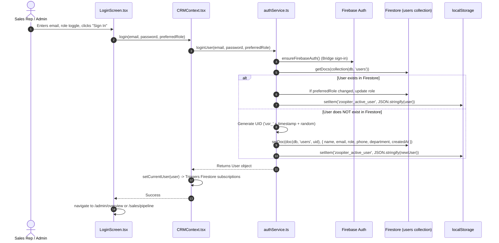

# SYNTRAXS CRM — Firebase Authentication Architecture & Migration Specification

> **Document Status**: Complete & Verified  
> **Target Application**: `lovable-syntraxs-ui` (Syntraxs Technologies Enterprise CRM)  
> **Codebase Root**: `c:\Users\Asus\Downloads\Syntraxs-Proj\zoopiter_crm_oct\lovable-syntraxs-ui`  
> **Date**: October 2026  
> **Author**: Senior Firebase Architect & Security Engineer  

---

## 1. Executive Summary

This document presents a technical audit of the authentication and session lifecycle in **SYNTRAXS CRM** (`lovable-syntraxs-ui`), analyzing how the frontend interacts with Firebase Authentication, handles session persistence, maps users to Firestore profiles, enforces role-based route guards, and triggers real-time data subscriptions.

A critical finding of this audit is that **the current application implements a hybrid two-tier authentication architecture**:
1. **Tier 1 (Firebase Auth Backend Bridge)**: Uses a shared administrative Firebase Auth session (`admin@zoopiter.com`) initialized automatically in the background to authenticate the client SDK against Firebase so that Firestore security rules (`request.auth != null`) allow reads and writes.
2. **Tier 2 (Application User Identity & Role Session)**: Individual users sign in with their email address. The application checks the Firestore `users` collection, extracts their assigned role (`admin` or `sales`), and persists this user object in the browser's `localStorage` (`zoopiter_active_user`).

Understanding this two-tier model is vital to ensure that connecting to the new Firebase project reproduces identical behavior without authentication regressions.

---

## 2. Authentication Initialization & Background Bridge

### 2.1 Firebase Auth Client Initialization
In `src/config/firebase.ts`, the Firebase Authentication instance is initialized as follows:

```typescript
// src/config/firebase.ts
import { initializeApp, getApps, getApp } from 'firebase/app';
import { getAuth, Auth } from 'firebase/auth';

const isFirebaseConfigured = () => {
  return !!(
    import.meta.env.VITE_FIREBASE_API_KEY &&
    import.meta.env.VITE_FIREBASE_PROJECT_ID
  );
};

if (isFirebaseConfigured()) {
  const firebaseConfig = {
    apiKey: import.meta.env.VITE_FIREBASE_API_KEY,
    authDomain: import.meta.env.VITE_FIREBASE_AUTH_DOMAIN,
    databaseURL: import.meta.env.VITE_FIREBASE_DATABASE_URL,
    projectId: import.meta.env.VITE_FIREBASE_PROJECT_ID,
    storageBucket: import.meta.env.VITE_FIREBASE_STORAGE_BUCKET,
    messagingSenderId: import.meta.env.VITE_FIREBASE_MESSAGING_SENDER_ID,
    appId: import.meta.env.VITE_FIREBASE_APP_ID,
    measurementId: import.meta.env.VITE_FIREBASE_MEASUREMENT_ID,
  };

  app = getApps().length > 0 ? getApp() : initializeApp(firebaseConfig);
  auth = getAuth(app);
}
```

### 2.2 Background Auth Bridge (`ensureFirebaseAuth`)
In `src/services/authService.ts`, the application maintains a background session to ensure Firestore operations pass backend security rules:

```typescript
export const ensureFirebaseAuth = async (): Promise<boolean> => {
  if (!isFirebaseEnabled() || !auth) return false;
  if (auth.currentUser) return true;

  try {
    await signInWithEmailAndPassword(auth, 'admin@zoopiter.com', 'admin123456');
    return true;
  } catch (err: any) {
    if (
      err?.code === 'auth/user-not-found' ||
      err?.code === 'auth/invalid-credential' ||
      err?.code === 'auth/invalid-login-credentials'
    ) {
      try {
        await createUserWithEmailAndPassword(auth, 'admin@zoopiter.com', 'admin123456');
        return true;
      } catch {
        // Ignored
      }
    }
    return false;
  }
};
```

> [!IMPORTANT]
> In the new Firebase project, either:
> 1. The service bridge account (or an equivalent provisioned admin credential) must be permitted to auto-create or be pre-created in Firebase Auth; OR
> 2. Full individual Firebase Auth accounts must be provisioned for each team member if moving away from the bridge model.

---

## 3. Login Workflow & User Profile Mapping

### 3.1 Step-by-Step Login Sequence



### 3.2 Distinguishing Firebase Auth vs. Firestore Profiles

| Aspect | Firebase Authentication User | Firestore `users` Profile Document |
| :--- | :--- | :--- |
| **Storage Location** | Google Identity Platform | Cloud Firestore `users/{userId}` |
| **Current Project ID** | Previous environment project | Previous environment project |
| **Identifier Strategy** | Alphanumeric Firebase UID | `usr_<base36_timestamp>_<random4>` |
| **Role Awareness** | None (Custom Claims not currently used) | Field `role: 'admin' \| 'sales'` |
| **Application Reliance** | Token validity for Firestore read/write | Business identity, assigned leads, quotas, activity logging |

---

## 4. Role Determination & Permissions

### 4.1 Allowed Roles
- `'admin'`: Full management console access (`/admin/overview`, `/admin/leads`, `/admin/team`, `/admin/targets`, `/admin/revenue`, `/admin/reports`). Can switch between Admin and Sales views.
- `'sales'`: Restricted to personal sales cockpit (`/sales/pipeline`, `/sales/activity`, `/sales/quota`). Only accesses leads assigned to their name or user ID.

### 4.2 Auto-Role Assignment Logic
When a new user signs in for the first time without an explicit role selection:
1. If the email contains `'admin'`, `'cso'`, or `'manager'`, role defaults to `'admin'`.
2. Otherwise, role defaults to `'sales'`.
3. If the user explicitly selects "Admin" or "Sales" via the toggle on `LoginScreen.tsx`, that role takes precedence and is updated in Firestore.

---

## 5. Route Guards & Session Persistence

### 5.1 Route Protection Implementation
Route guards are implemented via TanStack Router layouts in `src/routes/admin.tsx` and `src/routes/sales.tsx`:

#### Admin Layout (`src/routes/admin.tsx`)
```typescript
function AdminLayout() {
  const { currentUser, loading } = useCRM();
  const navigate = useNavigate();
  const [mounted, setMounted] = useState(false);

  useEffect(() => { setMounted(true); }, []);

  useEffect(() => {
    if (!mounted || loading) return;
    if (!currentUser) {
      navigate({ to: "/login", replace: true });
    } else if (currentUser.role !== "admin") {
      navigate({ to: "/sales/pipeline", replace: true });
    }
  }, [currentUser, loading, navigate, mounted]);

  if (!mounted || !currentUser || currentUser.role !== "admin") return null;

  return (
    <AppShell role="admin">
      <Outlet />
    </AppShell>
  );
}
```

#### Sales Layout (`src/routes/sales.tsx`)
```typescript
function SalesLayout() {
  const { currentUser, loading } = useCRM();
  const navigate = useNavigate();
  const [mounted, setMounted] = useState(false);

  useEffect(() => { setMounted(true); }, []);

  useEffect(() => {
    if (!mounted || loading) return;
    if (!currentUser) {
      navigate({ to: "/login", replace: true });
    }
  }, [currentUser, loading, navigate, mounted]);

  if (!mounted || !currentUser) return null;

  return (
    <AppShell role="sales">
      <Outlet />
    </AppShell>
  );
}
```

### 5.2 Session Persistence Mechanism
- Active session is stored in `localStorage` under key `zoopiter_active_user`.
- On application mount, `CRMContext.tsx` reads `authService.getActiveUser()`.
- If an active user exists, `loading` begins as `true`, `currentUser` is initialized, and background Firebase authentication is verified.

---

## 6. Real-time Subscription Lifecycle & Teardown

Firestore real-time listeners are tightly scoped to the `currentUser` lifecycle in `CRMContext.tsx`:

```typescript
useEffect(() => {
  if (!currentUser) {
    setLeads([]);
    setUsers([]);
    setTargets([]);
    setActivities([]);
    setLoading(false);
    return;
  }

  if (!isFirebaseEnabled()) {
    setLoading(false);
    return;
  }

  setLoading(true);
  let unsubLeads: () => void = () => {};
  let unsubUsers: () => void = () => {};
  let unsubTargets: () => void = () => {};
  let unsubActivities: () => void = () => {};
  let cancelled = false;

  authService.ensureFirebaseAuth().then((ready) => {
    if (!cancelled && ready) {
      unsubLeads = leadService.subscribeToLeads((fetchedLeads) => {
        if (!cancelled) { setLeads(fetchedLeads || []); setLoading(false); }
      });
      unsubUsers = userService.subscribeToUsers((fetchedUsers) => {
        if (!cancelled) setUsers(fetchedUsers || []);
      });
      unsubTargets = targetService.subscribeToTargets((fetchedTargets) => {
        if (!cancelled) setTargets(fetchedTargets || []);
      });
      unsubActivities = activityService.subscribeToActivities((fetchedActs) => {
        if (!cancelled) setActivities(fetchedActs || []);
      });
    }
  });

  return () => {
    cancelled = true;
    unsubLeads();
    unsubUsers();
    unsubTargets();
    unsubActivities();
  };
}, [currentUser]);
```

---

## 7. Logout Sequence

When the user clicks "Sign out" from `AppShell.tsx`:
1. `CRMContext.logout()` invokes `authService.logoutUser()`.
2. `localStorage.removeItem('zoopiter_active_user')` is called.
3. `auth.signOut()` terminates the active Firebase session.
4. All in-memory state (`currentUser`, `leads`, `users`, `targets`, `activities`) is cleared to empty arrays.
5. TanStack router redirects to `/login`.

---

## 8. Test Accounts & Quick Login Configuration

On `LoginScreen.tsx`, the UI provides 4 pre-configured 1-click test credentials for developer and staging convenience:

| Quick Label | Email | Assigned Role | Preset Password |
| :--- | :--- | :--- | :--- |
| **Sales (Masthan)** | `mastanvali@bristletech.com` | `sales` | `password123` |
| **Sales (Rajesh)** | `rajesh@bristletech.com` | `sales` | `password123` |
| **Admin (Zoopiter)**| `admin@zoopiter.com` | `admin` | `password123` |
| **Admin (Krishna)** | `krishnaprasad@bristletech.com` | `admin` | `password123` |

> [!WARNING]
> These credentials must NOT be migrated as live production company credentials. In the new Firebase project, production users must be provisioned under the new company's domain (`@syntraxs.com`).

---

## 9. Migration Requirements for Authentication

To ensure the new Firebase project functions seamlessly without breaking authentication:
1. **Enable Email/Password Provider**: Firebase Console > Authentication > Sign-in method > Email/Password must be enabled.
2. **Authorize Domains**: Add localhost (`localhost`, `127.0.0.1`), the new company production domain, and hosting domains (Vercel/Cloudflare) to Authorized Domains in Firebase Auth.
3. **Bridge Account**: Ensure Firebase Auth allows creating/signing in with the administrative bridge account (`admin@zoopiter.com` or custom company admin) so Firestore rules pass.
4. **Seed Firestore Users**: Pre-populate initial administrator and sales rep profiles in Firestore `users` collection matching the new company team roster.
