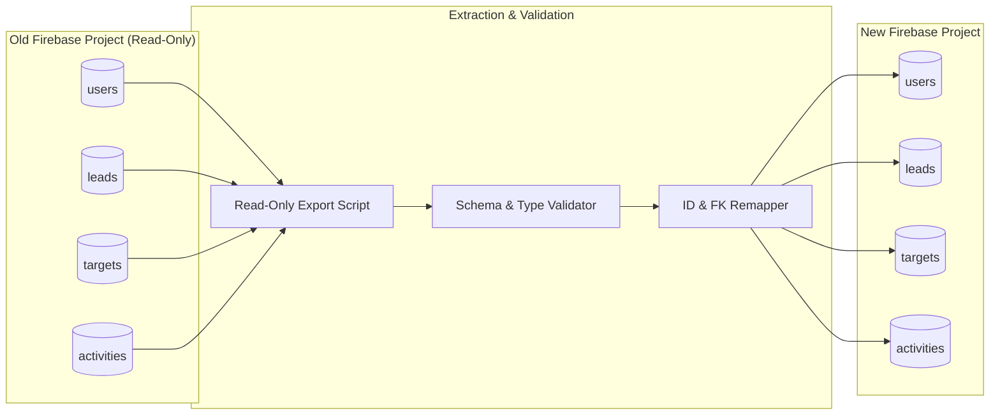

# SYNTRAXS CRM — Firebase Data Migration & Compatibility Plan

> **Document Status**: Complete & Verified  
> **Target Application**: `lovable-syntraxs-ui` (Syntraxs Technologies Enterprise CRM)  
> **Codebase Root**: `c:\Users\Asus\Downloads\Syntraxs-Proj\zoopiter_crm_oct\lovable-syntraxs-ui`  
> **Date**: October 2026  
> **Author**: Senior Database Migration Specialist & QA Architect  

---

## 1. Executive Summary

This plan provides actionable, fail-safe procedures to transition **SYNTRAXS CRM** to the new Firebase project. It covers two distinct business scenarios:
- **Scenario A: Fresh CRM Deployment (Greenfield / Empty Start)**: The new company begins with an empty database, fresh sales team roster, and clean pipeline.
- **Scenario B: Historical Data Transfer (Migration / Parity Cutover)**: Historical leads, team members, target quotas, and interaction ledgers are extracted from the old Firebase project, scrubbed, transformed, validated, and loaded into the new project with complete relationship integrity.

> [!CAUTION]
> **Data Protection Directive**: Under no circumstances should write or delete operations be executed against the old Firebase project during this process. The old project must remain completely intact and read-only throughout the migration.

---

## 2. Scenario A — Fresh CRM Deployment Plan

In Scenario A, the new Firebase project starts with no legacy records. The CRM must be bootstrapped so that the first administrator can immediately log in and begin provisioning team members and importing leads.

### 2.1 Step 1: Initialize New Project Infrastructure
1. Create new Firebase project in target region (`asia-south1` or preferred).
2. Enable Cloud Firestore in production mode.
3. Deploy the composite indexes specified in `docs/new-firebase-project-requirements.md`.
4. Deploy the production security rules.
5. Enable **Email/Password** in Firebase Authentication.

### 2.2 Step 2: Seed Initial Administrator Profile
1. Create administrative credentials in Firebase Authentication:
   - Email: `admin@syntraxs.com` (or company designated address).
   - Password: Secure 16+ character passphrase.
2. In Cloud Firestore, insert the root administrator document into the `users` collection:
   ```json
   // Document path: users/usr_admin_root
   {
     "name": "Super Administrator",
     "email": "admin@syntraxs.com",
     "role": "admin",
     "phone": "+91 9999999999",
     "department": "Management",
     "createdAt": "2026-10-18T00:00:00.000Z"
   }
   ```

### 2.3 Step 3: Seed Company Sales Representatives
Insert the initial sales team into the `users` collection:
```json
// Document path: users/usr_sales_01
{
  "name": "Arjun Mehta",
  "email": "arjun@syntraxs.com",
  "role": "sales",
  "phone": "+91 9811122233",
  "department": "Sales",
  "createdAt": "2026-10-18T00:00:00.000Z"
}
```

### 2.4 Step 4: Configure Initial Target Quotas
For each sales representative, insert a baseline monthly quota into the `targets` collection:
```json
// Document path: targets/tgt_202610_usr_sales_01
{
  "userId": "usr_sales_01",
  "type": "monthly",
  "period": "2026-10",
  "target": 1500000,
  "achieved": 0,
  "createdAt": "2026-10-18T00:00:00.000Z"
}
```

### 2.5 Step 5: Verification & Readiness
1. Point `.env` to the new project credentials.
2. Log in as `admin@syntraxs.com`.
3. Verify that the Executive Overview displays `0` leads, the created sales reps in the scorecard, and target quotas.
4. Use the in-app **Excel Import** (`/admin/leads`) to upload initial enterprise leads.

---

## 3. Scenario B — Historical Data Transfer Plan

Scenario B applies if historical leads, team performance records, and activity histories must be migrated from the previous environment.

### 3.1 Migration Architecture & Pipeline



### 3.2 Phase 1: Read-Only Data Extraction
1. Use Firebase Admin SDK or authorized client scripts to export each collection into JSON format:
   - `users.json`
   - `leads.json`
   - `targets.json`
   - `activities.json`
2. **Safety Rule**: Connect using read-only credentials or explicit fetch queries. Never call `deleteDoc` or `updateDoc` on the source database.

### 3.3 Phase 2: Data Cleansing & Normalization
Before importing into the new project, apply the following data transformation pipeline:

1. **User ID Harmonization**:
   - Ensure every user has a consistent `id` field matching their document ID.
   - Maintain a lookup map: `UserMap = { [oldUserId]: newUserId }` and `UserEmailMap = { [email]: newUserId }`.
2. **Lead Assignment Preservation**:
   - Update `lead.assignedTo` to match the mapped user ID.
   - Ensure `assignedToName` matches `user.name`.
   - Preserve dual-property compatibility: set both `companyName` and `company`, `contactName` and `client`, `rep` and `assignedToName`.
3. **Date & Timestamp Serialization**:
   - Convert Firestore `Timestamp` objects (`{ _seconds, _nanoseconds }`) to ISO 8601 strings or recreate native `Timestamp` instances on write.
   - Ensure `nextFollowUp` format matches `YYYY-MM-DDTHH:mm`.
4. **Follow-Up State Preservation**:
   - Preserve exact follow-up status: `'pending'`, `'reminded'`, `'completed'`, `'overdue'`.
   - Preserve `followUpOverdueReason` (`'dismissed'` or `'no_action'`).
5. **Target Associations**:
   - Remap `target.userId` using `UserMap`.
   - Ensure `type` is normalized to `'monthly'` or `'weekly'`.
6. **Activity Links**:
   - Remap `activity.userId` using `UserMap`.
   - Verify `activity.leadId` references a valid document in the migrated `leads` dataset.
   - Harmonize `who` / `userName` and `what` / `description`.

### 3.4 Phase 3: Ordered Import Execution
To maintain referential integrity, records must be loaded in strict hierarchical order:

```
Step 1: Import users       (Foundation for assignments and activities)
Step 2: Import leads       (Foundation for lead-specific activities)
Step 3: Import targets     (Linked to users)
Step 4: Import activities  (Linked to both users and leads)
```

#### Batch Write Strategy:
- Use Firestore batch writes (`writeBatch(db)`) with a maximum of **250 operations per batch** (well within Firestore's 500-op limit).
- Add a 200ms pause between batches to prevent concurrency spikes.

### 3.5 Phase 4: Data Integrity Verification & Audit

| Verification Metric | Validation Script / Method | Expected Result |
| :--- | :--- | :--- |
| **Record Counts** | `count(old_collection) == count(new_collection)` | 100% parity across `leads`, `users`, `targets`, `activities`. |
| **Assigned Lead Integrity**| Query leads where `assignedTo != null` | 100% resolve to an existing `users` document. |
| **Follow-Up Integrity** | Query leads where `nextFollowUp != null` | Valid dates; reminder states preserved without premature triggers. |
| **Won Revenue Parity** | Sum `value` for all `status == 'won'` leads | Exact penny match between old and new database. |
| **Target Achievement** | Verify quota realization calculations | Matches historical dashboard reports. |
| **Activity Timeline** | Inspect lead drawer on 10 random sample leads | Historical calls, emails, and notes appear in correct chronological order. |

---

## 4. Rollback Strategy

In the event of an unexpected regression during migration cutover:
1. The old Firebase configuration is preserved in source control and environment backups.
2. Re-applying the previous `.env` values and triggering a redeployment instantly restores connections to the original project.
3. Because the source database is never modified during this migration, the fallback path carries zero data loss risk.
