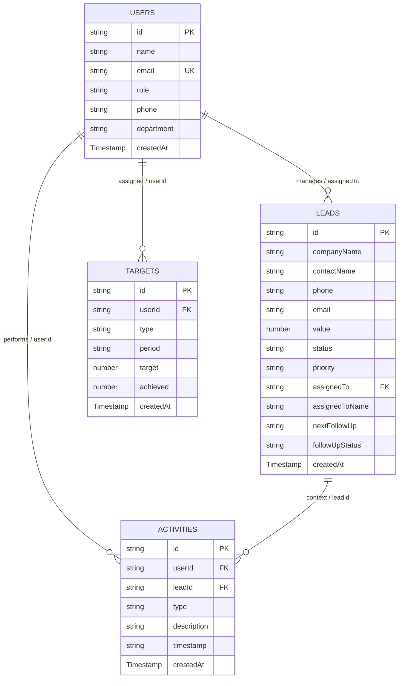

# SYNTRAXS CRM — Firebase Migration Audit & Data Structure Specification

> **Document Status**: Complete & Verified  
> **Target Application**: `lovable-syntraxs-ui` (Syntraxs Technologies Enterprise CRM)  
> **Codebase Root**: `c:\Users\Asus\Downloads\Syntraxs-Proj\zoopiter_crm_oct\lovable-syntraxs-ui`  
> **Date**: October 2026  
> **Author**: Senior Firebase Architect & Database Migration Specialist  

---

## 1. Executive Summary

This audit provides a comprehensive, verified specification of all Firestore database collections, document schemas, query behaviors, realtime listeners, and indexing requirements currently powering the **SYNTRAXS CRM** application (`lovable-syntraxs-ui`).

The application connects to Firebase using the **Firebase v12 JS SDK** (`^12.19.0`), orchestrating data across 4 primary Firestore collections:
1. **`leads`** (Core sales pipeline, contact details, status lifecycles, and follow-up reminders)
2. **`users`** (CRM user profiles, roles, contact info, and department alignments)
3. **`targets`** (Weekly and monthly quota target definitions)
4. **`activities`** (Audit trail of calls, emails, WhatsApp messages, meetings, notes, and won deals)

All findings in this document are derived directly from the application source code (`src/services/*`, `src/context/CRMContext.tsx`, `src/types/index.ts`, `src/routes/*`, and `src/components/crm/*`).

---

## 2. Global Data Normalization & Architectural Patterns

### 2.1 Date and Timestamp Handling
The codebase exhibits a hybrid timestamp model resulting from legacy compatibility:
- **Server Writes**: Operations write Firestore `Timestamp.now()` for `createdAt` and `updatedAt` metadata fields.
- **Client Records**: Forms and imports write ISO 8601 strings (`new Date().toISOString()`) for business dates (`createdAt`, `lastContact`, `followUpRemindedAt`, `followUpCompletedAt`).
- **Scheduling**: Follow-up dates use HTML5 `datetime-local` input format strings (`YYYY-MM-DDTHH:mm`).
- **Display Dates**: Date normalization handles string formats, Firestore `Timestamp` objects (`.toDate()`), and numeric Unix timestamps (`seconds * 1000`).

### 2.2 Compatibility Aliases
Due to the modernization from Zoopiter CRM to Syntraxs CRM, entities maintain dual property accessors:
- `companyName` <-> `company`
- `contactName` <-> `client`
- `assignedToName` <-> `rep`
- `description` <-> `what`
- `companyName` <-> `meta`
- `userName` <-> `who`

Normalizers in `src/services/leadService.ts` and `src/services/activityService.ts` automatically harmonize these keys on every read and write.

---

## 3. Collection Specifications

---

### Collection 1: `leads`

#### 3.1 Overview
- **Collection Name**: `leads`
- **Purpose**: Primary repository of business opportunities, customer contact details, financial value, sales rep assignments, status progression, and automated follow-up scheduling.
- **Classification**: **ESSENTIAL (Mission Critical)**.

#### 3.2 Document ID Strategy
- **Strategy**: Firestore auto-generated alphanumeric document IDs (via `addDoc(collection(db, 'leads'), ...)`).
- **Format**: Standard 20-character Firestore UIDs (e.g., `4kLmN8vR1xQyZ3aBcDeF`).

#### 3.3 Field Schema & Types

| Field Name | Firestore Data Type | Required / Optional | Default Value | Description / Permitted Values |
| :--- | :--- | :--- | :--- | :--- |
| `id` | `string` | Auto (Doc ID) | Firestore Doc ID | Unique lead document identifier. |
| `sno` | `number` | Optional | Index in list | Sequence order number (displayed as `#01`, `#02`). |
| `companyName` | `string` | **Required** | `""` | Official organization / enterprise name. |
| `contactName` | `string` | **Required** | `""` | Primary contact person's full name. |
| `company` | `string` | Optional (Alias) | Derived | Backwards compatibility mirror of `companyName`. |
| `client` | `string` | Optional (Alias) | Derived | Backwards compatibility mirror of `contactName`. |
| `designation` | `string` | Optional | `""` | Job title of contact (e.g. "CTO", "VP Engineering"). |
| `phone` | `string` | Optional | `""` | Contact phone number (with country code if provided). |
| `email` | `string` | Optional | `""` | Primary contact email address. |
| `requirement` | `string` | Optional | `""` | Project scope / tech requirements (e.g., "Custom CRM rollout"). |
| `category` | `string` | Optional | `"General"` | Account tier: `"Enterprise"`, `"SMB"`, `"Government"`, `"Startup"`, `"General"`. |
| `source` | `string` | Optional | `"Excel Import"` / `"Inbound"` | Origin channel: `"Inbound"`, `"Referral"`, `"Outbound"`, `"Events"`, `"Partners"`, `"Excel Import"`. |
| `audience` | `string` | Optional | `""` | Audience classification (legacy compatibility). |
| `value` | `number` | **Required** | `0` | Estimated deal value in INR (₹). Normalizes numeric strings. |
| `status` | `string` (enum) | **Required** | `'new'` | Allowed: `'new'`, `'quotation_sent'`, `'interested'`, `'not_able_to_contact'`, `'not_interested'`, `'won'`, `'pending_payment'`, `'follow_up'`, `'lost'`, `'dnp'`. |
| `priority` | `string` (enum) | **Required** | `'medium'` | Allowed: `'low'`, `'medium'`, `'high'`. |
| `assignedTo` | `string` | Optional | `null` / `undefined` | User ID of assigned sales rep (`users.id`). |
| `assignedToName` | `string` | Optional | `undefined` | Display name of assigned sales rep. |
| `rep` | `string` | Optional (Alias) | `undefined` | Backwards compatibility mirror of `assignedToName`. |
| `date` | `string` | Optional | Current YYYY-MM-DD | Business date of lead creation. |
| `createdAt` | `string` \| `Timestamp` | **Required** | `ISO string` | Timestamp of lead entry creation. |
| `updatedAt` | `Timestamp` | Auto on update | `Timestamp.now()` | Last document update timestamp. |
| `timestamp` | `Timestamp` | Optional | `Timestamp.now()` | Firestore timestamp instance attached on write. |
| `lastContact` | `string` | Optional | `""` | Timestamp or date of most recent interaction. |
| `nextFollowUp` | `string` | Optional | `undefined` | Scheduled follow-up time (`YYYY-MM-DDTHH:mm`). Drives reminder system. |
| `followUpStatus` | `string` (enum) | Optional | `'pending'` | Allowed: `'pending'`, `'reminded'`, `'completed'`, `'overdue'`. |
| `followUpRemindedAt` | `string` | Optional | `undefined` | ISO timestamp when 5-minute countdown popup triggered. |
| `followUpCompletedAt` | `string` | Optional | `undefined` | ISO timestamp when rep marked "Called" or resolved. |
| `followUpOverdueReason` | `string` (enum) | Optional | `null` | Allowed: `'dismissed'`, `'no_action'`, `null`. |
| `interestedAt` | `string` | Optional | `undefined` | ISO timestamp when lead status transitioned to 'interested'. |
| `interestedBy` | `string` | Optional | `undefined` | User ID of rep who marked the lead as interested. |
| `interestedByName` | `string` | Optional | `undefined` | Name of rep who marked the lead as interested. |
| `notes` | `string` | Optional | `""` | General notes and narrative history. |
| `productsOffered` | `string[]` | Optional | `[]` | Array of product or solution names pitched. |
| `callHistory` | `object[]` | Optional | `[]` | Array of: `{ date: string, type: 'call'\|'email'\|'whatsapp'\|'meeting'\|'note', notes: string }`. |
| `history` | `object[]` | Optional | `[]` | Array of audit logs: `{ type, timestamp, changedBy, changedByName, oldValue, newValue, details }`. |
| `finalStatus` | `string` (enum) | Optional | `undefined` | Quality rating: `'valid'`, `'misleading'`, `'junk'`. |

#### 3.4 Normalization Rules (`normalizeLead`)
- Handles missing `companyName` by falling back to `company` or `'Unknown Company'`.
- Handles missing `contactName` by falling back to `client` or `'Unknown Contact'`.
- Normalizes `createdAt` whether incoming format is string, Firestore `Timestamp` with `.toDate()`, or seconds dictionary.
- Coerces `value` to a strict numeric float/integer. Defaults to `0`.
- Ensures dual-property synchronization: `company` === `companyName`, `client` === `contactName`, `rep` === `assignedToName`.

#### 3.5 Firestore Queries & Listeners

```typescript
// 1. Real-time Subscription: All leads ordered by creation (used by CRMContext)
const q = query(collection(db, 'leads'), orderBy('createdAt', 'desc'));
onSnapshot(q, (snapshot) => { ... });

// 2. Real-time Subscription: User-specific leads
const qUser = query(
  collection(db, 'leads'),
  where('assignedTo', '==', userId),
  orderBy('createdAt', 'desc')
);
onSnapshot(qUser, (snapshot) => { ... });

// 3. One-time Fetch: All leads
getDocs(collection(db, 'leads'));

// 4. One-time Fetch: Specific lead by document ID
getDoc(doc(db, 'leads', leadId));

// 5. One-time Fetch: Filter by assigned user
query(collection(db, 'leads'), where('assignedTo', '==', userId));
```

#### 3.6 CRUD Mutations
- **Add**: `addDoc(collection(db, 'leads'), payload)`
- **Update**: `updateDoc(doc(db, 'leads', leadId), { ...updates, updatedAt: Timestamp.now() })`
- **Delete**: `deleteDoc(doc(db, 'leads', leadId))`

#### 3.7 Composite Index Requirements
1. **Collection**: `leads`  
   - `assignedTo` (ASCENDING)  
   - `createdAt` (DESCENDING)  
   - *Query Scope*: Collection  
   *(Required for `subscribeToUserLeads`)*

---

### Collection 2: `users`

#### 3.8 Overview
- **Collection Name**: `users`
- **Purpose**: Defines sales reps, administrators, and team members. Provides role-based access data (`admin` vs `sales`), department categorization, and profile identity.
- **Classification**: **ESSENTIAL (Mission Critical)**.

#### 3.9 Document ID Strategy
- **Client Strategy**: `usr_${Date.now().toString(36)}_${Math.random().toString(36).substring(2, 6)}` (e.g. `usr_m4q9k8z_8f21`).
- **Legacy / Firebase Auth Alignment**: In earlier setup guides, Firebase Auth UID was used as document ID. The current system accepts both formats.

#### 3.10 Field Schema & Types

| Field Name | Firestore Data Type | Required / Optional | Default Value | Description / Permitted Values |
| :--- | :--- | :--- | :--- | :--- |
| `id` | `string` | Auto (Doc ID) | Generated UID | Unique identifier for user. |
| `name` | `string` | **Required** | `""` | Full display name (e.g., "Mastan Vali", "Krishna Prasad"). |
| `email` | `string` | **Required** | `""` | Lowercased email address used for login mapping. |
| `role` | `string` (enum) | **Required** | `'sales'` | Allowed: `'admin'`, `'sales'`. Controls UI capabilities and route guards. |
| `phone` | `string` | Optional | `""` | Contact phone number. |
| `department` | `string` | Optional | `'Sales'` / `'Management'` | Business department. |
| `avatar` | `string` | Optional | `undefined` | URL or asset path to user avatar. |
| `teamId` | `string` | Optional | `undefined` | Team / pod identifier. |
| `createdAt` | `Timestamp` | **Required** | `Timestamp.now()` | Account provisioning timestamp. |
| `updatedAt` | `Timestamp` | Optional | `Timestamp.now()` | Profile last modified timestamp. |

#### 3.11 Firestore Queries & Listeners

```typescript
// 1. Real-time Subscription: All users ordered by name (used by CRMContext)
const q = query(collection(db, 'users'), orderBy('name'));
onSnapshot(q, (snapshot) => { ... });

// 2. Fetch User Profile by Document ID
getDoc(doc(db, 'users', uid));

// 3. Scan Users by Email (used by findUserByEmail during login)
getDocs(collection(db, 'users'));
// Filtered in memory: data.email.toLowerCase() === normalizedEmail
```

#### 3.12 CRUD Mutations
- **Add**: `setDoc(doc(db, 'users', uid), userData)`
- **Update**: `updateDoc(doc(db, 'users', userId), { ...updates, updatedAt: Timestamp.now() })`
- **Delete**: `deleteDoc(doc(db, 'users', userId))`

#### 3.13 Index Requirements
- Default single-field index on `name` (ASCENDING) is automatically provided by Firestore.

---

### Collection 3: `targets`

#### 3.14 Overview
- **Collection Name**: `targets`
- **Purpose**: Defines sales performance quotas for individual team members across weekly and monthly intervals.
- **Classification**: **ESSENTIAL (Mission Critical)**.

#### 3.15 Document ID Strategy
- **Strategy**: Firestore auto-generated alphanumeric document IDs (via `addDoc`).

#### 3.16 Field Schema & Types

| Field Name | Firestore Data Type | Required / Optional | Default Value | Description / Permitted Values |
| :--- | :--- | :--- | :--- | :--- |
| `id` | `string` | Auto (Doc ID) | Firestore Doc ID | Target record identifier. |
| `userId` | `string` | **Required** | `""` | Identifier of sales rep (`users.id` or user's full name). |
| `type` | `string` (enum) | **Required** | `'monthly'` | Allowed: `'weekly'`, `'monthly'`. |
| `period` | `string` | **Required** | Current period | Formatted period: `YYYY-MM` (monthly) or `YYYY-Www` (weekly). |
| `target` | `number` | **Required** | `0` | Quota financial goal in INR (₹). |
| `achieved` | `number` | Optional | `0` | Stored historical achievement amount. *Note: UI computes live achievement from won leads, falling back to this field.* |
| `createdAt` | `Timestamp` | **Required** | `Timestamp.now()` | Target creation timestamp. |
| `updatedAt` | `Timestamp` | Optional | `Timestamp.now()` | Target modification timestamp. |

#### 3.17 Firestore Queries & Listeners

```typescript
// 1. Real-time Subscription: All targets ordered by creation (used by CRMContext)
const q = query(collection(db, 'targets'), orderBy('createdAt', 'desc'));
onSnapshot(q, (snapshot) => { ... });

// 2. Real-time Subscription: User targets ordered by creation
const qUser = query(
  collection(db, 'targets'),
  where('userId', '==', userId),
  orderBy('createdAt', 'desc')
);
onSnapshot(qUser, (snapshot) => { ... });

// 3. One-time Fetch: All targets
getDocs(collection(db, 'targets'));

// 4. One-time Fetch: Specific target
getDoc(doc(db, 'targets', targetId));
```

#### 3.18 Composite Index Requirements
1. **Collection**: `targets`  
   - `userId` (ASCENDING)  
   - `createdAt` (DESCENDING)  
   - *Query Scope*: Collection  
   *(Required for `subscribeToUserTargets`)*

---

### Collection 4: `activities`

#### 3.19 Overview
- **Collection Name**: `activities`
- **Purpose**: Complete chronological interaction and audit ledger documenting sales engagements (calls, emails, meetings, WhatsApp chats, notes, and won deal milestones).
- **Classification**: **ESSENTIAL (Mission Critical)**.

#### 3.20 Document ID Strategy
- **Strategy**: Firestore auto-generated alphanumeric document IDs (via `addDoc`).

#### 3.21 Field Schema & Types

| Field Name | Firestore Data Type | Required / Optional | Default Value | Description / Permitted Values |
| :--- | :--- | :--- | :--- | :--- |
| `id` | `string` | Auto (Doc ID) | Firestore Doc ID | Unique activity record identifier. |
| `userId` | `string` | **Required** | `""` | User ID of the rep who performed the activity. |
| `userName` | `string` | Optional | `""` | Display name of the rep. |
| `who` | `string` | Optional (Alias) | Derived | Backwards compatibility mirror of `userName`. |
| `leadId` | `string` | Optional | `undefined` | Associated lead document ID (`leads.id`). |
| `companyName` | `string` | Optional | `""` | Associated company / lead name. |
| `meta` | `string` | Optional (Alias) | Derived | Backwards compatibility mirror of interaction context. |
| `type` | `string` (enum) | **Required** | `'note'` | Allowed: `'call'`, `'email'`, `'whatsapp'`, `'meeting'`, `'note'`, `'won'`. |
| `description` | `string` | **Required** | `""` | Description of the activity performed. |
| `what` | `string` | Optional (Alias) | Derived | Backwards compatibility mirror of `description`. |
| `timestamp` | `string` | **Required** | `ISO string` | Date and time when the interaction occurred. |
| `t` | `string` | Optional | Derived | Human-readable relative time (e.g., "Just now", "Yesterday", "Oct 6"). |
| `createdAt` | `Timestamp` | **Required** | `Timestamp.now()` | Activity write timestamp. |
| `updatedAt` | `Timestamp` | Optional | `Timestamp.now()` | Last modification timestamp. |

#### 3.22 Normalization Rules (`normalizeActivity`)
- Normalizes `timestamp` from ISO string, Firestore `Timestamp.toDate()`, or seconds dictionary.
- Computes `t` dynamically based on time elapsed: `< 24h` produces `hh:mm a`, `< 48h` produces `"Yesterday"`, older dates produce `"MMM d"`.
- Mirrors `what` <-> `description`, `who` <-> `userName`, and `meta` <-> `companyName`.

#### 3.23 Firestore Queries & Listeners

```typescript
// 1. Real-time Subscription: All activities ordered by timestamp (used by CRMContext)
const q = query(collection(db, 'activities'), orderBy('timestamp', 'desc'));
onSnapshot(q, (snapshot) => { ... });

// 2. Real-time Subscription: User activities ordered by timestamp
const qUser = query(
  collection(db, 'activities'),
  where('userId', '==', userId),
  orderBy('timestamp', 'desc')
);
onSnapshot(qUser, (snapshot) => { ... });

// 3. User activities with limit
const qLimit = query(
  collection(db, 'activities'),
  where('userId', '==', userId),
  orderBy('timestamp', 'desc'),
  limit(limitCount)
);

// 4. Activities for a specific lead
const qLead = query(collection(db, 'activities'), where('leadId', '==', leadId));
```

#### 3.24 Composite Index Requirements
1. **Collection**: `activities`  
   - `userId` (ASCENDING)  
   - `timestamp` (DESCENDING)  
   - *Query Scope*: Collection  
   *(Required for user activity history queries)*

2. **Single-Field Index**:  
   - `leadId` (ASCENDING)  
   - `timestamp` (DESCENDING)

---

## 4. Discovered Additional / Legacy Collections

During full codebase inspection, no additional active collections (such as `invoices`, `notifications`, or `settings`) were found in use.
- **In-Memory Derived Structures**: Notifications and follow-up reminders are derived client-side by polling the `leads` collection for `nextFollowUp` and `followUpStatus`.
- **Legacy Files**: In `zoopiter_crm_oct/syntraxs-crm-ui`, historical references exist to browser push messaging (`firebase-messaging-sw.js`), but in `lovable-syntraxs-ui`, browser notifications utilize standard HTML5 `Notification.requestPermission()` and `new Notification(...)` client-side API without Cloud Messaging server dependencies.

---

## 5. Entity Relationship Model



---

## 6. Audit Verdict

| Verification Item | Status | Evidence |
| :--- | :--- | :--- |
| **All Active Collections Identified** | ✅ Verified | `leads`, `users`, `targets`, `activities`. |
| **Field Schemas Documented** | ✅ Verified | Mapped against TypeScript definitions and normalizers in `src/services/*`. |
| **Document ID Strategy Documented** | ✅ Verified | Auto-IDs for `leads`, `targets`, `activities`; prefixed IDs (`usr_...`) for `users`. |
| **Required Composite Indexes Identified** | ✅ Verified | 3 composite indexes documented in Section 3. |
| **Security Rules Documented** | ✅ Verified | Documented against original specification in `FIREBASE_SETUP.md`. |
