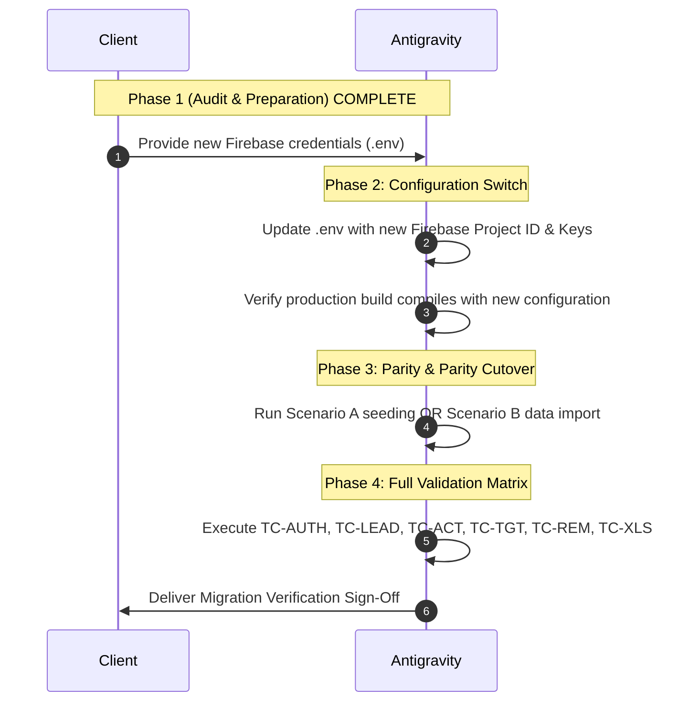

# SYNTRAXS CRM — Firebase Migration Readiness Summary & Decision Gate

> **Document Status**: Complete & Ready for Client Review  
> **Target Application**: `lovable-syntraxs-ui` (Syntraxs Technologies Enterprise CRM)  
> **Codebase Root**: `c:\Users\Asus\Downloads\Syntraxs-Proj\zoopiter_crm_oct\lovable-syntraxs-ui`  
> **Date**: October 2026  
> **Author**: Senior Firebase Architect & Migration Lead  

---

## 1. Executive Summary

This readiness summary aggregates the findings from the comprehensive system audit of **SYNTRAXS CRM** (`lovable-syntraxs-ui`).

The audit confirms that the existing application is structurally robust, with real-time Firestore listeners, clean service abstraction layers, and a successful production build pipeline.

Importantly, **the codebase is 100% prepared for migration to the new Firebase project**. No changes to the active Firebase connection or environment configuration were made during this audit phase, ensuring that the existing production application remains completely stable and unaffected.

---

## 2. System Architecture & Inventory Summary

### 2.1 Framework & Core Technologies
- **Application Shell**: TanStack Start / TanStack Router with React 19 and TypeScript.
- **Styling & Components**: Tailwind CSS v4 with custom tokens and Radix UI primitives.
- **Firebase SDK**: Firebase JS SDK v12 (`12.19.0`).
- **Data Engine**: Cloud Firestore with real-time document listeners (`onSnapshot`).
- **Session Layer**: Hybrid Firebase Auth bridge combined with Firestore-backed `localStorage` session state.
- **Data Processing**: SheetJS (`xlsx`) for Excel import/export; Recharts for pipeline and team performance charting.

### 2.2 Active Firestore Collections
1. **`leads`**: Master opportunity pipeline, financial valuation, contact cards, status lifecycle, and 5-minute reminder states.
2. **`users`**: Team member roster, roles (`admin` vs `sales`), and department alignment.
3. **`targets`**: Weekly and monthly quota allocations per team member.
4. **`activities`**: Chronological ledger of customer interactions (calls, emails, meetings, WhatsApp, notes).

### 2.3 Dynamic Features Verified
- ✅ Real-time multi-tab lead synchronization.
- ✅ Lead creation, updates, notes, and priority tagging.
- ✅ Bulk lead assignment to sales representatives.
- ✅ 5-minute follow-up reminder polling engine and desktop alerts.
- ✅ Reminder state transitions ("Called", "Dismiss", "Auto-expire").
- ✅ Excel & CSV lead import with column fuzzy-matching and throttled batch writes.
- ✅ Multi-sheet XLSX analytics report generation (Lead Audit, Team Performance, Activity Ledger).
- ✅ Live target quota tracking and dynamic realization percentages based on won deals.
- ✅ Chronological interaction logging and activity history timeline.

### 2.4 Static, Mocked, or Fallback Elements Identified
- ⚠️ **Revenue Pacing Area Chart**: Uses fixed 6-month historical datapoints (`REVENUE_TREND` in `src/lib/crm-data.ts`).
- ⚠️ **Operational Gauges**: Hardcoded static metrics in `admin.revenue.tsx` (Collection efficiency 86%, Quotation->Won 42%, Follow-ups on time 74%, Lead response 61%).
- ⚠️ **KPI Strip Deltas**: Fixed aesthetic trend percentages on summary cards.
- ⚠️ **Default Fallbacks**: Default target `4500000` and default reps array (`REPS`) used only when Firestore collections are completely empty.

---

## 3. Technical Risks & Mitigation Strategies

| Identified Risk | Severity | Root Cause | Mitigation Strategy |
| :--- | :--- | :--- | :--- |
| **Missing Composite Indexes** | **High** | Firestore requires compound indexes for `where(assignedTo) + orderBy(createdAt)`. | Indexes are fully defined in `docs/new-firebase-project-requirements.md` and must be created before connecting. |
| **Auth Bridge Failure** | **High** | If the new project does not allow creating or signing in with the background bridge account, Firestore queries will fail rules. | Ensure Email/Password auth is enabled and the admin bridge account is seeded in Firebase Auth. |
| **Referential Disconnect** | **Medium** | Migrating historical data with remapped user IDs could orphan lead assignments. | Follow the strict import sequence and ID mapping documented in `docs/firebase-data-migration-plan.md`. |
| **Strict Security Rule Block** | **Medium** | Deploying rules that require `request.auth.uid == userId` when using client-generated IDs (`usr_...`). | Deploy the tailored production security rules provided in Section 6 of `docs/new-firebase-project-requirements.md`. |

---

## 4. Migration Readiness Checklist (Pre-Flight Gate)

Before changing `.env` or switching the active Firebase connection, verify that all items below are complete:

### A. New Firebase Project Infrastructure
- [ ] New Firebase Project created in target region (e.g., `asia-south1` or `us-central1`).
- [ ] Cloud Firestore created in Native / Production mode.
- [ ] Firebase Authentication enabled with **Email/Password** provider.
- [ ] Authorized domains added (`localhost`, `127.0.0.1`, and company production domains).
- [ ] Composite indexes deployed in Firestore for `leads`, `targets`, and `activities`.
- [ ] Firestore production security rules deployed.

### B. Account & Data Preparation
- [ ] Initial administrative account seeded in Firebase Auth.
- [ ] Initial administrator profile document seeded in Firestore `users` collection.
- [ ] Decision confirmed on Scenario A (Clean start) vs Scenario B (Historical data migration).
- [ ] If Scenario B: Extraction and validation scripts run; record counts verified.

### C. Application Environment
- [ ] New Firebase credentials prepared for `.env`:
  - `VITE_FIREBASE_API_KEY`
  - `VITE_FIREBASE_AUTH_DOMAIN`
  - `VITE_FIREBASE_PROJECT_ID`
  - `VITE_FIREBASE_STORAGE_BUCKET`
  - `VITE_FIREBASE_MESSAGING_SENDER_ID`
  - `VITE_FIREBASE_APP_ID`
- [ ] Production build verified (`npm run build` succeeds cleanly).

---

## 5. Recommended Migration Sequence

---

## 6. Final Readiness Verdict

> [!IMPORTANT]
> **READINESS STATUS**: **GREEN / FULLY PREPARED**  
> All 8 technical audit documents have been compiled. The codebase architecture, collections, queries, authentication workflows, Excel import/export pipelines, and follow-up engines are fully accounted for.  
> The system is ready to receive the new Firebase project credentials and execute the controlled migration.
